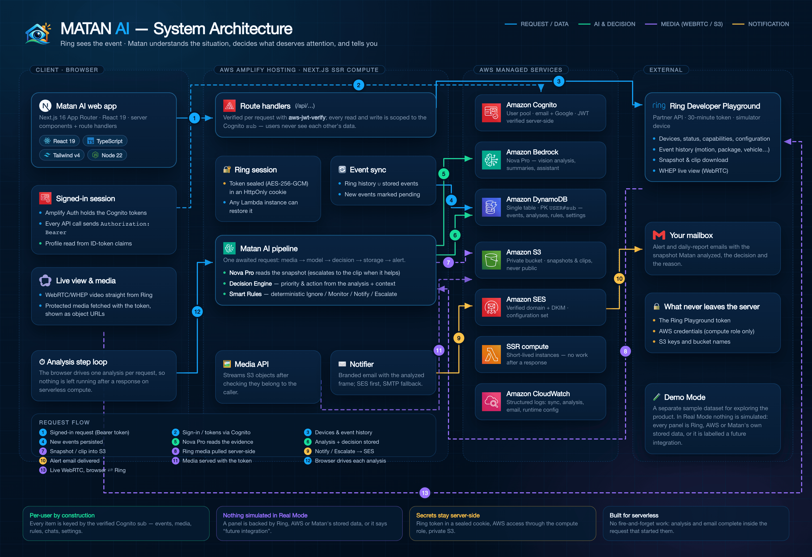

<div align="center">


# MATAN AI

**Ring sees the event. Matan AI understands the situation, decides what deserves attention, and tells you.**

_Matan_ means **“eye”** in Tetum, the language of Timor-Leste.

[](https://amazonappdev2026.devpost.com/)
[](https://amazonappdev2026.devpost.com/)
[](https://aws.amazon.com/bedrock/)
[](https://nextjs.org)
[](LICENSE)

</div>

---

A Ring camera tells you _something moved_. It cannot tell you whether that something matters. MATAN AI closes that gap: every Ring event is read by **Amazon Nova Pro**, scored by a deterministic **Decision Engine**, checked against **Smart Rules** you control, and only then — if it deserves your attention — turned into one clear email.

Built for the **Build, Ship, Shape: Amazon Developer Hackathon** (Ring track + AWS Builder mini challenge) against the real **Ring Developer Playground**, running on AWS.



## What it does

|                                          |                                                                                                                                                           |
| ---------------------------------------- | --------------------------------------------------------------------------------------------------------------------------------------------------------- |
| 🧠 **Understands, not just detects**     | Nova Pro reads the snapshot (and the clip when it helps) and returns a summary, category, confidence, observations and what it is unsure about.           |
| ⚖️ **Decides, and explains why**         | A deterministic Decision Engine turns the reading into a priority and an action; your Smart Rules have the last word. Every decision stores its reason.   |
| 🔕 **Stays quiet on purpose**            | Most events end as _Ignore_ or _Monitor_. Email is reserved for _Notify_ and _Escalate_ — with quiet hours, sensitivity and repeat detection you control. |
| 💬 **Answers questions about your home** | The assistant is grounded in your own devices, events, decisions and rules — never invented.                                                              |
| 📺 **Real Ring integration**             | WebRTC live view, on-demand snapshots, event history, device capabilities — all from the Ring API.                                                        |
| 🤝 **Honest by design**                  | Anything the Ring API or this build cannot do is labelled _future integration_ in the UI instead of being faked.                                          |

## See it

|                            |                                                                                                                |
| -------------------------- | -------------------------------------------------------------------------------------------------------------- |
| **Live demo**              | `https://main.d3q4rxuohabv2i.amplifyapp.com`                                                                   |
| **Documentation (in-app)** | [`/docs`](https://main.d3q4rxuohabv2i.amplifyapp.com/docs) — architecture, integrations and every page audited |
| **Demo Mode**              | Sign in and choose _Demo Mode_ to explore with sample data, no Ring account needed                             |
| **Real Mode**              | Paste a 30-minute Ring Developer Playground token and the whole app runs on real Ring data                     |

## Architecture at a glance

| Diagram                                                             | What it answers                                                |
| ------------------------------------------------------------------- | -------------------------------------------------------------- |
| [System architecture](docs/architecture/matan-ai-architecture.png)  | How the browser, the Next.js server, AWS and Ring fit together |
| [Event → alert lifecycle](docs/architecture/matan-ai-lifecycle.png) | What happens in the 2.7 seconds after Ring records something   |
| [Feature map](docs/architecture/matan-ai-features.png)              | What powers each page, and what is a future integration        |
| [Deployment & security](docs/architecture/matan-ai-deployment.png)  | How it ships to AWS and what it refuses to do with your data   |

**Stack:** Next.js 16 (App Router) · React 19 · TypeScript · Tailwind v4 · Amazon Cognito · Amazon Bedrock (Nova Pro) · Amazon DynamoDB · Amazon S3 · Amazon SES · AWS Amplify Hosting · Ring API (Developer Playground).

## Run it yourself

```bash
git clone https://github.com/ajitonelsonn/matan-ai.git
cd matan-ai
pnpm install
cp .env.example .env          # fill in the values below
pnpm cognito:provision        # user pool + app client
pnpm dynamodb:check           # table MatanAI (PK/SK)
pnpm s3:provision             # private media bucket
pnpm dev                      # http://localhost:3000
```

Full instructions — AWS resources, IAM policy, Google sign-in, SES verification and deploying to Amplify — are in **[docs/SETUP.md](docs/SETUP.md)** and **[docs/AWS_DEPLOYMENT.md](docs/AWS_DEPLOYMENT.md)**.

Demo Mode works with nothing but Cognito configured, so you can see the whole product before wiring any Ring or AI service.

## Documentation

Everything is in [`docs/`](docs/) and is also browsable inside the app at `/docs`:

- **[Architecture](docs/architecture/README.md)** — the four diagrams above, with the flows written out
- **[Real Mode page audit](docs/pages/README.md)** — every page: what is real, what is a future integration, and how it was verified
- **Implementation notes** — [Bedrock/Nova](docs/BEDROCK_NOVA_IMPLEMENTATION.md) · [Cognito auth](docs/COGNITO_AUTH_IMPLEMENTATION.md) · [DynamoDB](docs/DYNAMODB_IMPLEMENTATION.md) · [S3 media](docs/S3_MEDIA_IMPLEMENTATION.md) · [SES notifications](docs/SES_NOTIFICATIONS_IMPLEMENTATION.md) · [Care Context & Smart Rules](docs/CARE_CONTEXT_SMART_RULES.md) · [Ring device intelligence](docs/RING_ACCOUNT_DEVICE_INTELLIGENCE.md) · [AWS deployment](docs/AWS_DEPLOYMENT.md)

## Project principles

1. **Nothing is simulated in Real Mode.** A panel is backed by Ring, AWS or Matan's own stored data — or it is labelled a future integration.
2. **Per-user by construction.** Every stored item is keyed by the verified Cognito `sub`; one user's query can only read their own data.
3. **Secrets stay server-side.** The Ring token lives in a sealed HttpOnly cookie, AWS access goes through an IAM role, and the media bucket is private.
4. **Explainable decisions.** Model observations, engine reasons and the matched rule are stored with every event.

## Built in Timor-Leste 🇹🇱

Made in Dili for _Safer Homes, Stronger Communities_. The product is designed for places where a neighbour, a grandparent or a small shop owner needs to know what matters — without wading through a hundred motion alerts.

## License

[MIT](LICENSE) — you are free to run, modify and deploy your own instance. Ring, AWS and other marks belong to their respective owners.
