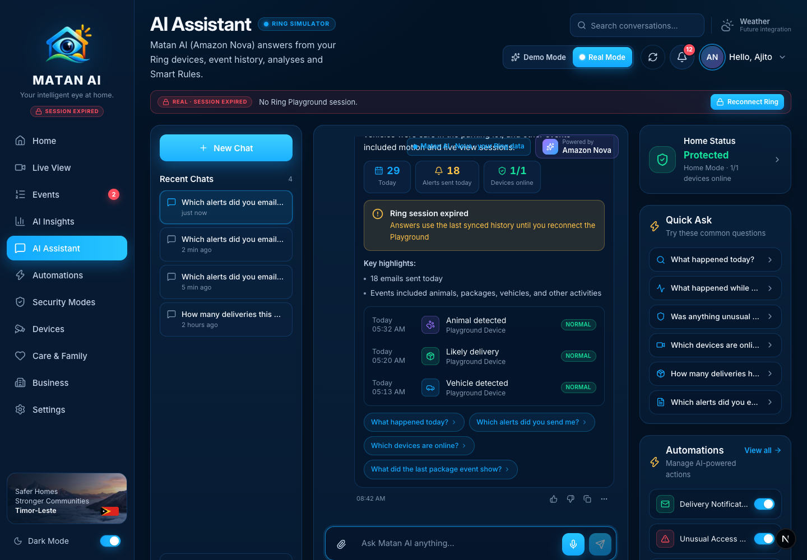
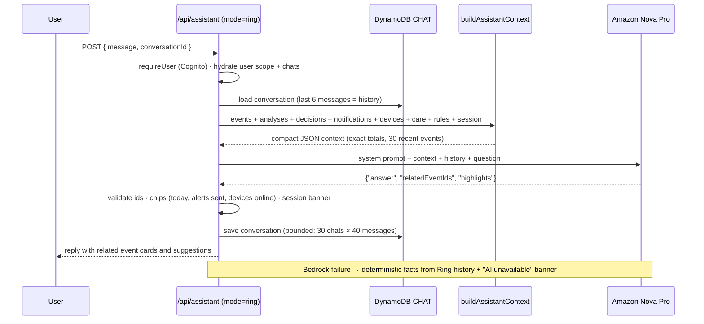
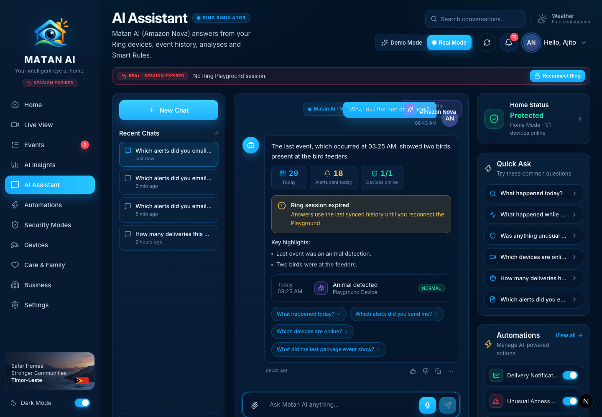

# AI Assistant — Real Mode

**Route:** `/assistant` · **Component:** `components/pages/AssistantPage.tsx` · **API:** `GET/POST/DELETE /api/assistant?mode=ring` · **Answering:** `lib/ring/assistant.ts` (`answerRing`) + `lib/matan/assistant-context.ts` (pure grounding/prompt/parse) · **Storage:** `lib/ring/assistant-store.ts` (DynamoDB `CHAT#{id}` per user)

The assistant lets the user ask Matan about their home in plain language. In Real Mode the answer is written by **Amazon Nova** from a grounding context that contains only the signed-in user's data: connected Ring devices, event history with Matan's analyses, decisions and notification outcomes, Care Context, Smart Rules, alert settings and the Playground session state. Conversations are stored per user and never mixed with Demo Mode's scripted chats.

## How it works

- **Grounding, not retrieval:** the model sees exact totals (today / last 7 days: events by type and priority, emails sent and by type), decision counts, notification outcomes, and the 30 most recent events with Matan's one-line analysis, decision and notification state. The system prompt forbids inventing anything outside the context and tells the model that device control is a future integration.
- **Related events:** the model returns ids; only ids that exist in the user's history are kept (max 3), and they render as clickable event cards.
- **Follow-ups** work because the last six messages of the conversation are sent with the question.
- **Privacy:** Real Mode conversations are keyed by the verified Cognito `sub` (DynamoDB `USER#{sub}` / `CHAT#{id}`); the previous implementation kept all users' chats in one shared in-memory list.

## Sections and functions

| Area | What it shows / does | Source | State |
| --- | --- | --- | --- |
| Recent Chats | The user's Real Mode conversations (newest first), relative time, delete per chat, **Clear all chats** | `GET/DELETE /api/assistant?mode=ring` | ✅ per-user, persisted |
| New Chat | Starts an empty conversation | client | ✅ |
| Search conversations | Filters the list by title | client | ✅ |
| Conversation | User/assistant messages; assistant replies carry **chips** (events today, alerts sent today, devices online), an optional **session banner**, **Key highlights**, **related event cards** and **suggestions** | `POST /api/assistant?mode=ring` | ✅ real (Nova) |
| Copy | Copies the answer | clipboard | ✅ |
| 👍 / 👎 | Toast only — storing feedback is a future integration | — | 🔒 future integration |
| Attach 📎 | Future integration (Matan already analyzes every event's clip/snapshot automatically) | — | 🔒 future integration |
| Voice input 🎤 | Future integration | — | 🔒 future integration |
| Quick Ask | Six grounded questions (today, while away, unusual/escalated this week, devices online, deliveries, alerts emailed and why) | client → POST | ✅ |
| Home Status | Active Matan security mode and devices online | `AppDataProvider` | ✅ (security modes are app-level, see Security Modes page) |
| Automations rail | Toggles from the Automations store | `/api/automations` | ⚠️ audited on the Automations page |

### Follow-up questions

## Future integrations shown on this page
- **Attachments**, **voice input**, **feedback storage** — labelled in their toasts.
- **Device control through the assistant** (siren, lights, lock) — the model is instructed to say this is a future integration rather than pretend.

## Changes made during the Real Mode audit
- Replaced the keyword-matching Real Mode answers (which still said events were "awaiting analysis" and that AI "starts with the Bedrock milestone") with a Nova-grounded assistant: `lib/matan/assistant-context.ts` (context, prompt, tolerant JSON parse), `answerRing` rewrite with deterministic fallback, exact-count grounding (`emailsSent`, `emailsSentByType`).
- Per-user conversation persistence in DynamoDB (`lib/ring/assistant-store.ts`); the route requires the Cognito user for Ring mode on GET/POST/DELETE, and **Clear all** only clears the current mode's chats (`assistantApi.clear(id, mode)`).
- Quick Ask questions rewritten to what the grounded assistant can answer well; subtitle and badge state the model and data source.
- Relative times in Real Mode use the real clock (`timeAgo` in the chat list and the top-bar inbox).
- Unit tests: `tests/assistant-context.test.ts`.

## Verified
- 2026-09-21, signed-in Real Mode session (Playground token expired → banner shown, answers from synced history): *"Which alerts did you email me today and why?"* → "18 emails for 6 animal, 6 package, 4 vehicle and 2 other events…" (matches the *Alerts sent today* chip) with 3 related events; *"Can you turn on the siren?"* → explains device control is a future integration; *"What did the last one show?"* (follow-up) → the 06:18 bird-feeder event, ignored by rules, with the correct related event; conversations persisted across reloads.
