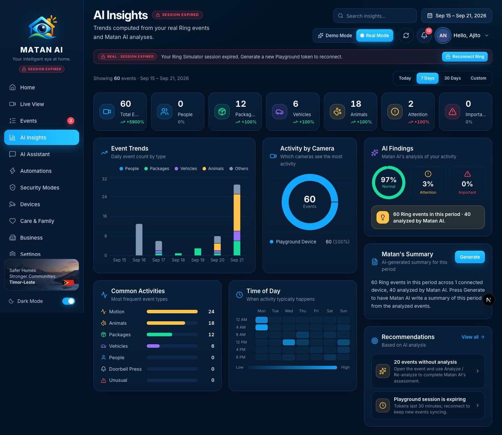
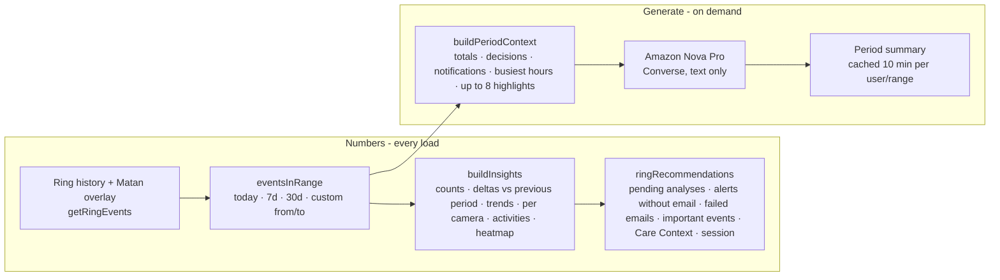
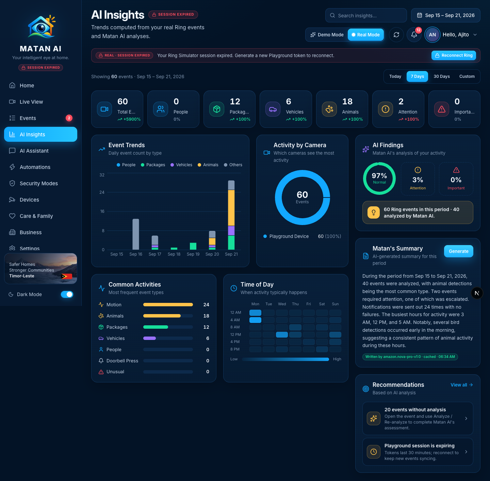
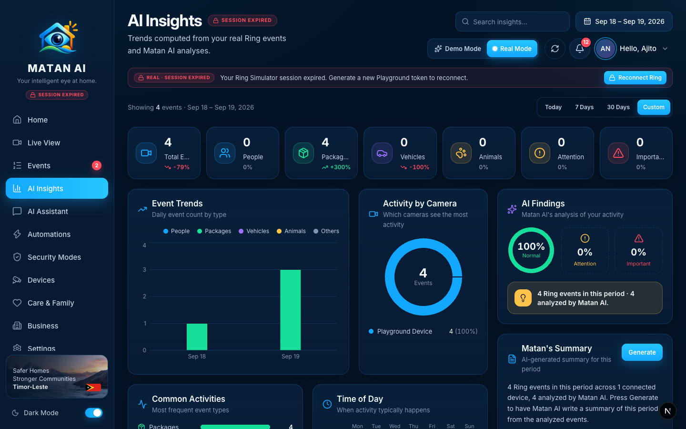

# AI Insights — Real Mode

**Route:** `/insights` · **Component:** `components/pages/InsightsPage.tsx` · **Data:** `GET /api/ring/overview/insights?range=…&from=…&to=…` → `buildRingInsights` (`lib/ring/overview.ts`) · **Summary:** `POST /api/matan/insights/summary` → `generatePeriodSummary` (`lib/matan/insights-generate.ts`)

AI Insights turns the user's Ring history into trends: counts by type and priority, day-by-day chart, activity per camera, time-of-day heatmap, Matan's findings, an AI-written period summary and recommendations. In Real Mode every number is computed from the signed-in user's real Ring events (with Matan's analyses attached); the summary is written on demand by Amazon Nova from those same analyzed events, and the recommendations are derived from the user's data, settings and session — no sample text.

## How it works

- **Previous-period deltas** compare the window with the same number of days immediately before it; with a young Playground account the first days have a handful of events, so deltas like +5900 % are real arithmetic, not decoration.
- **Thin history guard:** with fewer than 10 events on record the page shows *Building your insights* instead of charts built on nothing.
- **Generate** never invents: the prompt contains only the aggregated facts (`PeriodContext`) and Nova is told to use nothing else. When the period has no analyzed events the API answers without calling the model.
- The summary is cached for 10 minutes per user/period (invalidated when new events or analyses arrive) so repeated clicks do not spend tokens; the badge shows the model, *cached* and the time.

## Sections and functions

| Area | What it shows / does | Source | State |
| --- | --- | --- | --- |
| Range tabs | Today / 7 Days / 30 Days / **Custom** | `?range=` | ✅ |
| Custom date range | From/To pickers → applied to real history (up to 90 days, clamped to today); label and URL follow | `?from=&to=` (`resolveWindow`) | ✅ real (Demo keeps its 14-day sample) |
| Search | Filters Common Activities rows and Recommendations by text | client | ✅ |
| Metric cards | Total, People, Packages, Vehicles, Animals, Attention, Important with % vs previous period | `counts`, `deltas` | ✅ |
| Event Trends | Stacked daily counts by type for the window | `trends` | ✅ |
| Activity by Camera | Events per connected Ring device (one device in the Playground) | `byCamera` | ✅ |
| Common Activities | Ranked event types | `activities` | ✅ |
| Time of Day | Weekday × 4-hour heatmap in the care-context/app timezone | `heatmap` | ✅ |
| AI Findings | Normal / Attention / Important share from Matan's priorities; note with events recorded vs analyzed | `findings`, `findingNote` | ✅ |
| Matan's Summary → **Generate** | Nova-written 3–5 sentence summary of the analyzed events in the window; badge with model, cache state and time | `POST /api/matan/insights/summary` | ✅ real (Demo: simulated, says so) |
| Recommendations | Up to four data-driven cards with links: *N events without analysis* → Events; *Add an alert email address* → Settings › Notifications; *Some alert emails failed*; *N important events* → Events filtered; *Turn on Care Context* → Settings › Care & Rules; *Playground session expiring / expired* → Reconnect dialog; *No action needed* | `ringRecommendations` | ✅ |

### Generate (real)

### Custom range (real)

## Future integrations shown on this page
- None on the page itself; the **Weather** chip in the top bar remains a future integration.

## Changes made during the Real Mode audit
- **Generate** replaced a fake 1.3 s timer with a real Nova call (`generateTextWithNova` in `lib/bedrock/nova.ts`, pure context builder in `lib/matan/insights-summary.ts`, cached server module `lib/matan/insights-generate.ts`, route `app/api/matan/insights/summary`). Demo Mode now says its summary is simulated.
- **Custom range** is applied for real (`InsightWindow` support in `lib/mock/insights.ts`: `resolveWindow`, `eventsInRange`, `rangeLabel`, trends) instead of silently using the last 14 days; invalid ranges are rejected.
- **Recommendations** are computed from the user's events, alert settings, Care Context and Playground session, each with its own link (`Insight.href`), replacing two static tips whose clicks led to unrelated pages.
- Subtitle and placeholder summary text describe what is real (counts from Ring history, analyses by Matan AI).
- Unit tests: `tests/insights-summary.test.ts` (period context aggregation, custom-window clamping).

## Verified
- 2026-09-21, signed-in Real Mode session: 7-day window = 60 real events (12 packages · 6 vehicles · 18 animals · 24 motion), **Generate** → `amazon.nova-pro-v1:0` summary of 40 analyzed events (second click served from cache), Today window → 27 events summarized, custom range Sep 18–19 → 4 events with matching label and chart; recommendations showed *20 events without analysis* and the session state.
