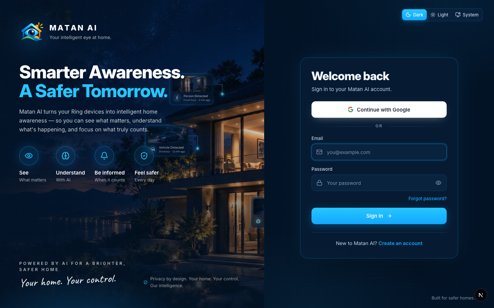
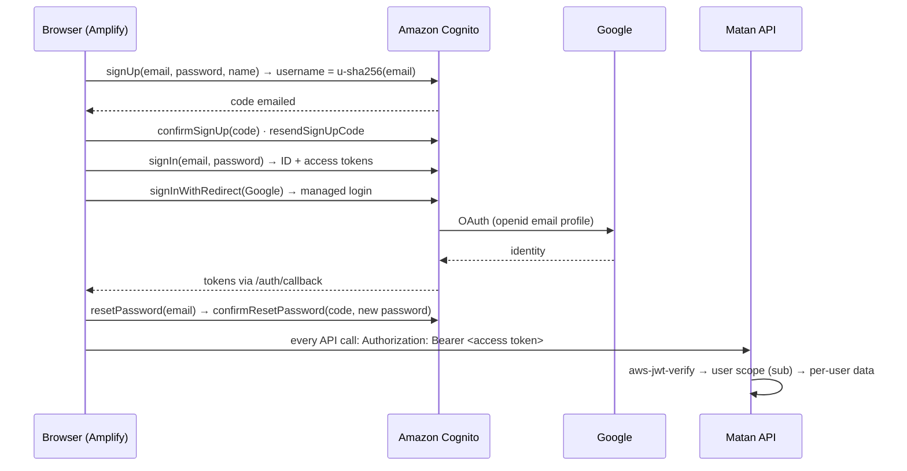
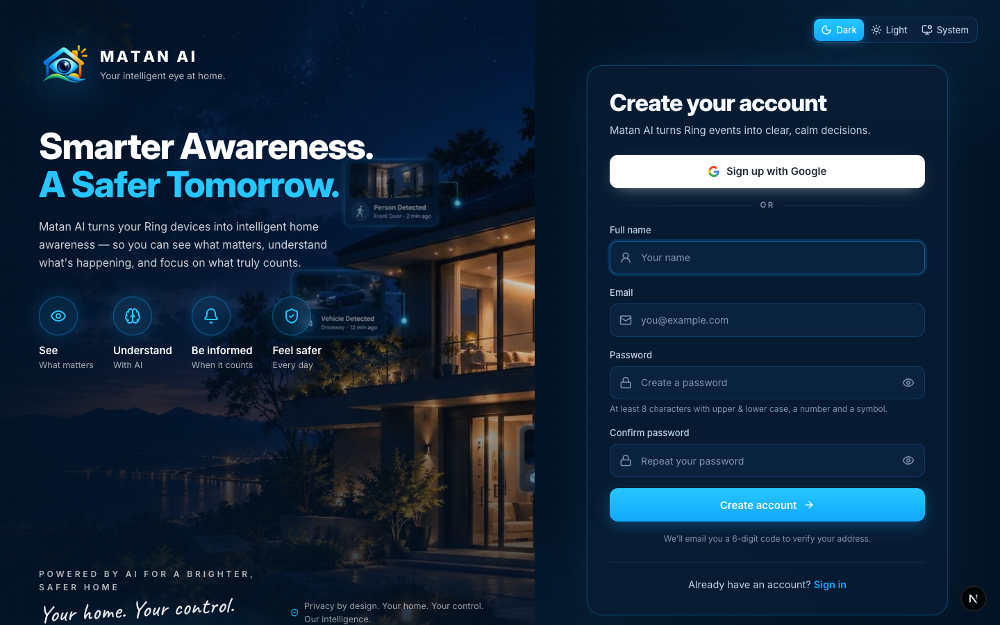
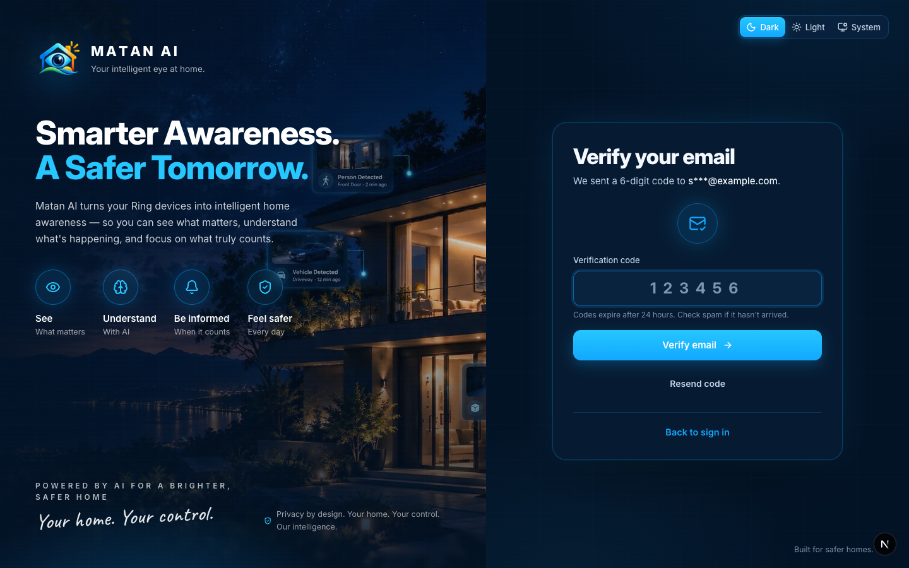
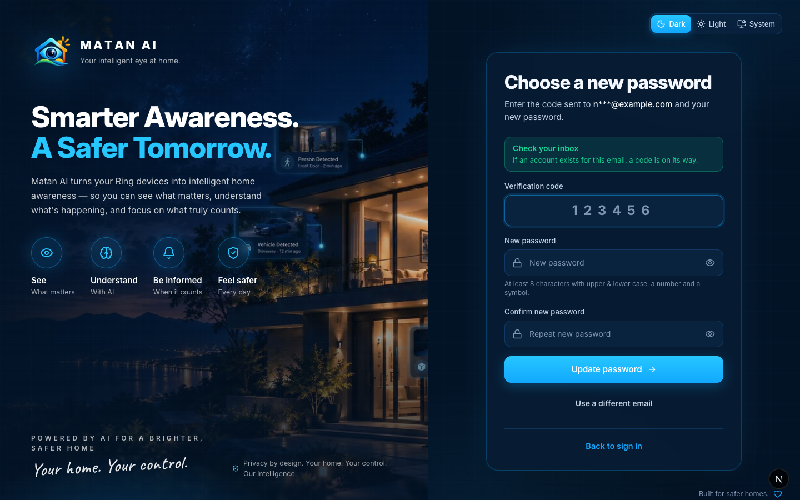
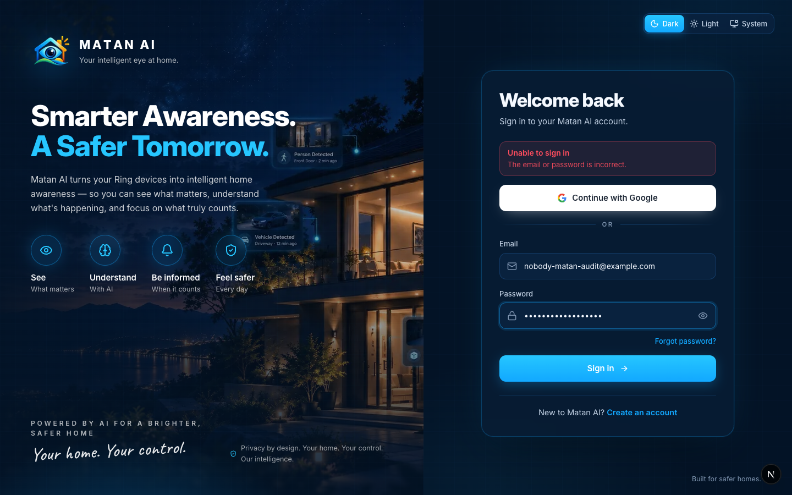
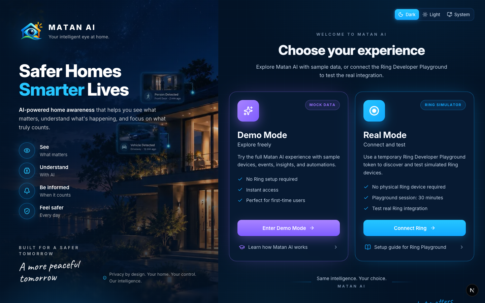

# Sign in, Sign up & Mode chooser

**Routes:** `/login`, `/register`, `/verify-email`, `/forgot-password`, `/auth/callback` (Google) · **Components:** `components/auth/*` (`AuthLayout`, `LoginForm`, `SignUpForm`, `VerifyEmailForm`, `ForgotPasswordForm`, `GoogleSignInButton`, `AuthGuard`, `AuthProvider`), `components/experience/mode-selection.tsx` · **Backend:** Amazon Cognito user pool (email + password, Google identity provider) through AWS Amplify v6; server routes verify the access token with `aws-jwt-verify`

Every account action here is a real Amazon Cognito operation — there is no demo login. The pages are shared by Demo and Real Mode (a person signs in first, then chooses the experience); Demo Mode only changes what data the app shows afterwards.

## How it works

- The pool uses **email as an alias**, so Matan derives an opaque username from the email (`u-<sha256(email)[0:20]>`) for sign-up/confirm/resend; users never see it.
- The profile shown in the app (name, email, photo) comes from the **ID token claims**, which works for both email/password and Google accounts.
- **Route guard:** any app route opened signed-out redirects to `/login?next=<route>` and returns there after sign-in.
- After sign-in the **mode chooser** is shown once per browser session (`sessionStorage`), remembering the last choice as the default.

## Pages and functions

| Page | What it does | Cognito call | State |
| --- | --- | --- | --- |
| Sign in | Email + password, **Forgot password?**, **Continue with Google**, link to create an account; wrong credentials → *Unable to sign in · The email or password is incorrect.* | `signIn`, `signInWithRedirect` | ✅ real |
| Create account | Full name, email, password (policy: 8+ chars, upper/lower, number, symbol — validated client-side and by Cognito), **Sign up with Google** | `signUp` | ✅ real |
| Verify email | 6-digit code (masked email shown), **Verify email**, **Resend code**, back to sign in | `confirmSignUp`, `resendSignUpCode` | ✅ real |
| Reset password | Email → code → new password + confirmation; the response never reveals whether the account exists (*If an account exists for this email, a code is on its way*) | `resetPassword`, `confirmResetPassword` | ✅ real |
| Google callback | Exchanges the managed-login code for tokens and returns to `next` | Amplify OAuth listener | ✅ real |
| Theme switch | Dark / Light / System on the auth layout | client | ✅ |
| Mode chooser | **Enter Demo Mode** (sample data) or **Connect Ring** (Playground token dialog → Real Mode); *Learn how Matan AI works* → About, *Setup guide* → Ring Playground docs | client | ✅ |
| Sign out | Settings → Sign out; clears the Cognito session and the mode-chosen flag | `signOut` | ✅ |

### Sign up · Verify email · Reset password

### Wrong password

### Mode chooser (after sign-in)

## Future integrations
- **Two-factor authentication** — MFA is not enabled on the user pool (labelled in Settings).
- **Editing name / photo** — profile attributes come from Cognito/Google; an edit flow is not built (labelled in Settings).
- Other identity providers (Apple, Facebook) are not configured; only Google is offered.

## Changes made during the Real Mode audit
- None required — the flows were implemented and verified in the Cognito milestone (`docs/COGNITO_AUTH_IMPLEMENTATION.md`, `docs/GOOGLE_OAUTH_COGNITO_SETUP.md`); this audit re-verified them signed-out and added the screenshots.

## Verified
- 2026-09-21, fresh signed-out browser profile: all four pages render; wrong password → real Cognito error after ~5 s; weak/missing sign-up fields → client validation before any Cognito call; password reset for an unknown email → non-enumerating *Check your inbox* step; `/events` signed out → `/login?next=%2Fevents`; mode chooser shown to the signed-in user in a new session. Full sign-up → verification → sign-in and Google sign-in were verified live in the Cognito milestone.
