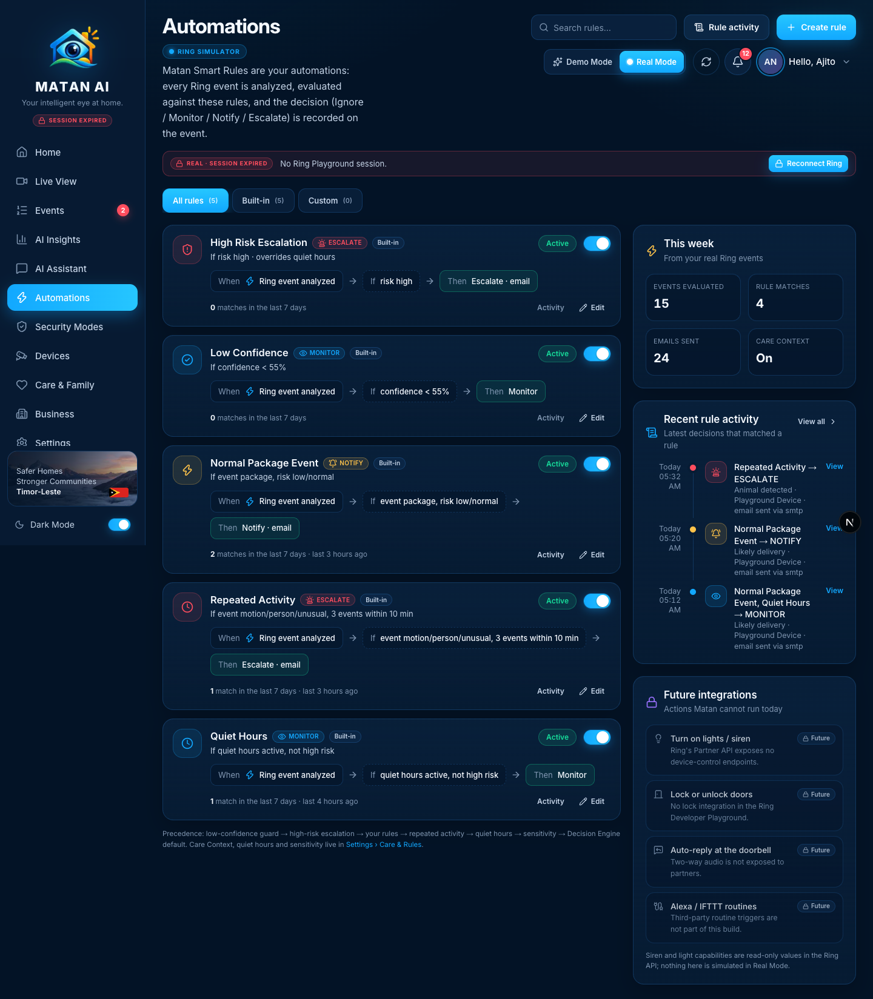
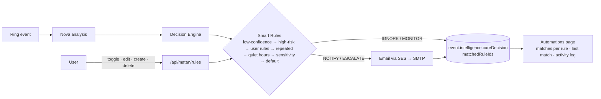
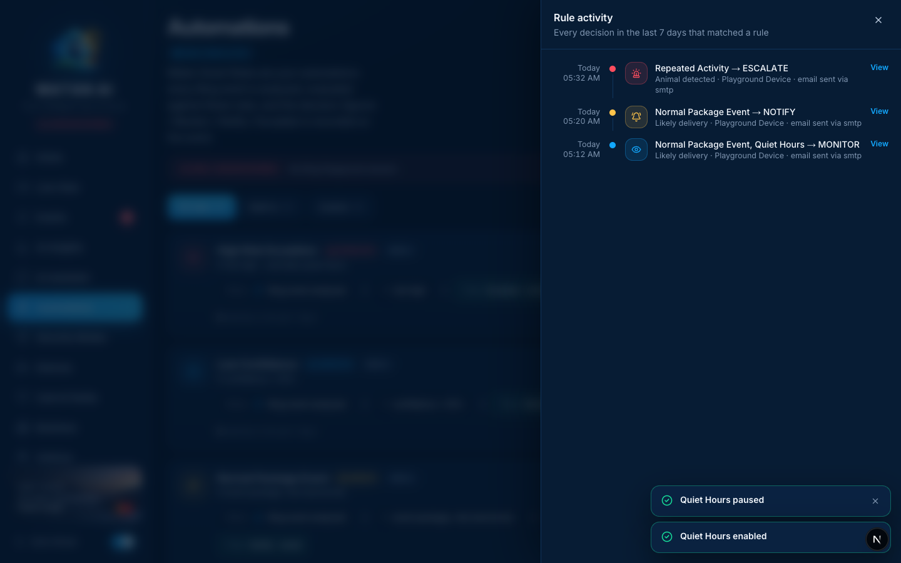
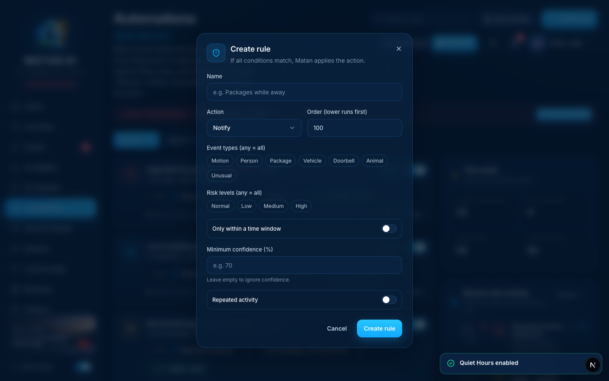

# Automations — Real Mode

**Route:** `/automations` · **Component:** `components/automations/ring-automations-view.tsx` (Real Mode; `components/pages/AutomationsPage.tsx` keeps the Demo view) · **Data:** `GET/POST/PATCH/DELETE /api/matan/rules`, `GET/PUT /api/matan/care`, `GET /api/ring/events?range=7d`

In Real Mode the automations **are Matan's Smart Rules**. Every Ring event is analyzed by Nova, then evaluated against the rules in a fixed precedence; the resulting decision (Ignore / Monitor / Notify / Escalate) and the ids of the rules that matched are stored on the event, and Notify/Escalate trigger the email alert. So this page's run counts and activity log are derived from the user's real events — the Demo page's sample automations (shared store, simulated "turn on lights" actions, invented run counters) are never shown in Real Mode.

## How it works

- **Matches in the last 7 days** for a rule = number of events (last 7 days) whose stored decision lists that rule in `matchedRuleIds`; _last_ = the newest such event.
- **Rule activity** = every decision that matched at least one rule, newest first, with the outcome (action + whether an email was sent and by which provider) and a link to the event.
- Rules are evaluated only while **Care Context** is on; the page shows a callout with a one-click switch when it is off.

## Sections and functions

| Area                                      | What it shows / does                                                                                                                           | Source                        | State                 |
| ----------------------------------------- | ---------------------------------------------------------------------------------------------------------------------------------------------- | ----------------------------- | --------------------- |
| Tabs                                      | All / Built-in / Custom with counts                                                                                                            | rules                         | ✅                    |
| Search                                    | Filters rules by name or condition text                                                                                                        | client                        | ✅                    |
| Rule card                                 | Name, action badge, _Built-in_, condition sentence, When → If → Then flow, **matches in the last 7 days** and last match time, _Active/Paused_ | rules + events                | ✅ real               |
| Toggle                                    | Enables/pauses the rule for future events                                                                                                      | `PATCH /api/matan/rules/{id}` | ✅                    |
| Edit                                      | Opens the rule editor (name, action, order, event types, risk levels, time window, minimum confidence, repeated activity)                      | `PATCH`                       | ✅                    |
| Delete                                    | Custom rules only — built-ins can be paused, not deleted                                                                                       | `DELETE`                      | ✅                    |
| Create rule                               | Same editor → new custom rule                                                                                                                  | `POST /api/matan/rules`       | ✅                    |
| Activity (per rule) / Rule activity (all) | Drawer with the matching decisions of the last 7 days, outcome and **View** link to the event                                                  | events                        | ✅ real               |
| This week                                 | Events evaluated, rule matches, emails sent, Care Context on/off                                                                               | events, care                  | ✅                    |
| Recent rule activity                      | Last five matches                                                                                                                              | events                        | ✅                    |
| Future integrations                       | Lights/siren, locks, doorbell auto-reply, Alexa/IFTTT routines — with the reason each is not possible today                                    | —                             | 🔒 future integration |
| Care Context off callout                  | Explains rules are inactive and turns Care Context on                                                                                          | `PUT /api/matan/care`         | ✅                    |

### Rule activity

### Create rule

## Future integrations shown on this page

- **Device actions** (lights, siren, locks) — the Ring API exposes capability values read-only and no control endpoints.
- **Doorbell auto-reply** — two-way audio is not exposed to partners.
- **Alexa / IFTTT routines** — third-party routine triggers are out of scope for this build.

## Changes made during the Real Mode audit

- New `RingAutomationsView`: Real Mode now renders Smart Rules with real match statistics and an activity log instead of the demo automation store (which is shared across users and simulates actions).
- `RuleEditor` exported from `components/care/CareRulesPanel.tsx` and reused for create/edit here.
- AI Assistant right rail shows the user's Smart Rules (real toggles) in Real Mode instead of demo automations.
- Demo Mode page unchanged apart from a fixed _Demo_ badge.

## Verified

- 2026-09-21, signed-in Real Mode session: 5 built-in rules with real 7-day matches (Normal Package Event 2, Repeated Activity 1, Quiet Hours 1), _This week_ = 15 events evaluated · 4 matches · 24 emails; pause/enable Quiet Hours → `PATCH 200` both ways; Rule activity drawer lists the matching decisions with email outcomes; Create rule opens the editor.
