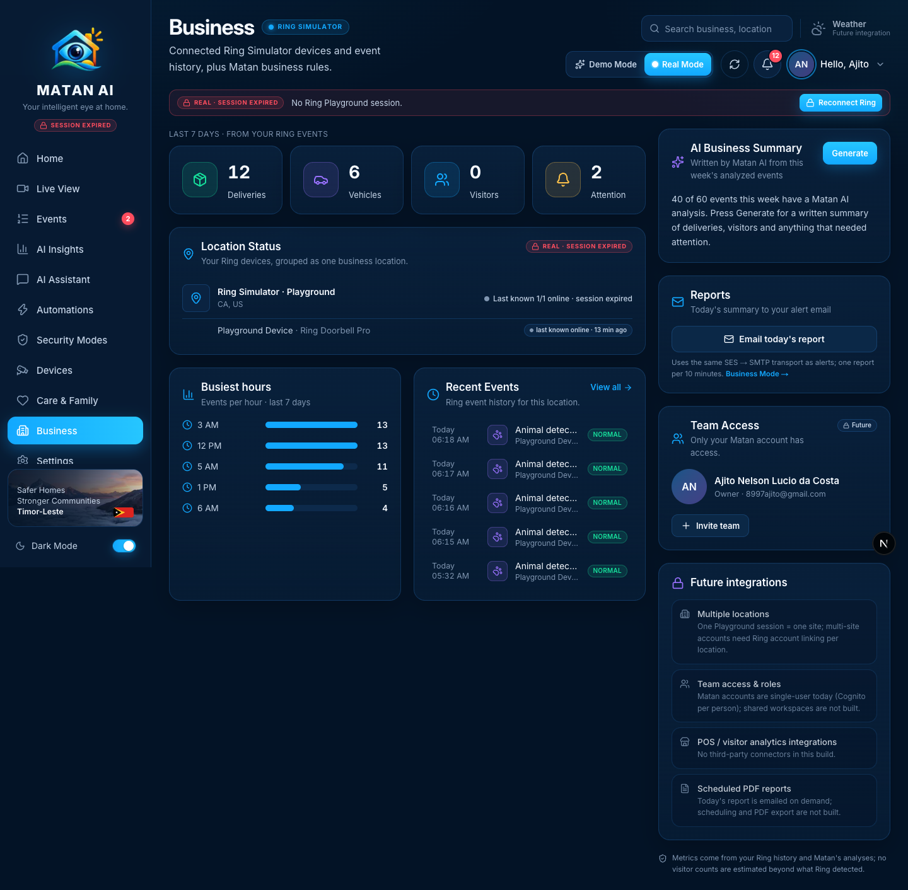
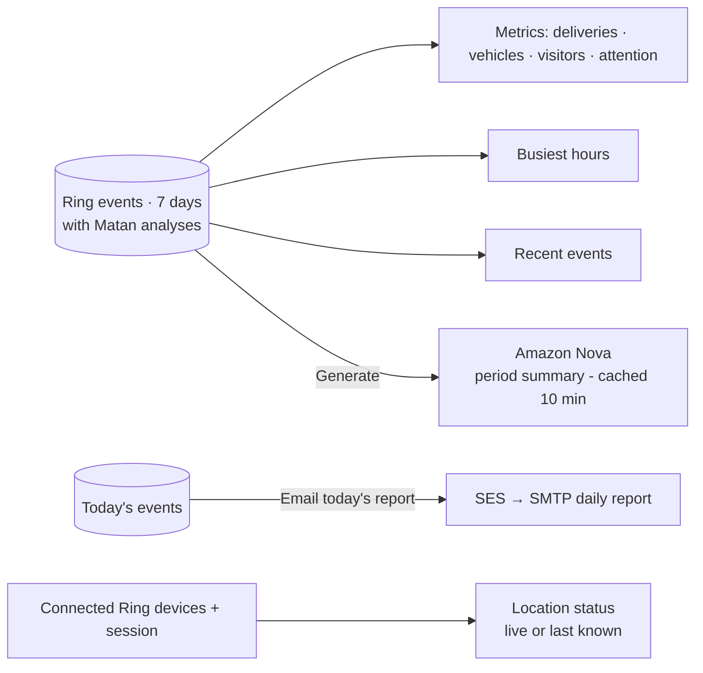

# Business — Real Mode

**Route:** `/business` · **Components:** `components/pages/BusinessPage.tsx` → `components/experience/real-mode-business.tsx` (Real Mode) · **APIs:** `GET /api/ring/events?range=7d`, `POST /api/matan/insights/summary`, `POST /api/matan/report`, `/api/ring/session`

Business presents the same Ring installation from a small-business angle: one location, its devices, delivery/vehicle/visitor activity, busiest hours, an AI-written weekly summary and the daily report email. In Real Mode all of it comes from the user's Ring history and Matan's analyses; multi-location, team roles and third-party integrations are listed as future work instead of being simulated (Demo Mode keeps its sample locations, team and integrations).

## How it works

## Sections and functions

| Area | What it shows / does | Source | State |
| --- | --- | --- | --- |
| Metric cards | Deliveries, vehicles, visitors (person + doorbell), events needing attention — last 7 days | Ring history + Matan priorities | ✅ real |
| Location Status | The Playground grouped as one location: region, online count; per-device status (live, or *last known · N min ago* when the session is expired) | Ring discovery | ✅ |
| Busiest hours | Top five hours by event count (7 days) | Ring history | ✅ |
| Recent Events | Latest five events, click → event page; **View all** | Ring history | ✅ |
| AI Business Summary → **Generate** | Nova-written summary of the week's analyzed events (same engine and cache as AI Insights) | `POST /api/matan/insights/summary` | ✅ real |
| Reports → **Email today's report** | Sends today's real summary to the alert address (SES → SMTP, one per 10 minutes; *already sent* / *not sent* reported honestly) | `POST /api/matan/report` | ✅ real |
| Team Access | The signed-in owner; **Invite team** explains multi-user accounts are a future integration | Cognito profile | 🔒 future integration |
| Future integrations | Multiple locations, team access & roles, POS / visitor-analytics connectors, scheduled PDF reports — each with the reason | — | 🔒 future integration |

## Future integrations shown on this page
- **Multiple locations** — one Playground session is one site.
- **Team access & roles** — Matan accounts are single-user (one Cognito identity each).
- **POS / visitor analytics** — no third-party connectors.
- **Scheduled PDF reports** — reports are emailed on demand only.

## Changes made during the Real Mode audit
- Replaced the stale Real Mode view ("Awaiting Matan AI analysis… once the Bedrock pipeline runs", "Invite team (next milestone)", generic counters) with real 7-day business metrics, busiest hours, a Nova summary and the real report email.
- Device status honours the expired-session rule (*last known*, not a live "online").
- The demo business API is no longer fetched in Real Mode.

## Verified
- 2026-09-21, signed-in Real Mode session: 12 deliveries · 6 vehicles · 0 visitors · 2 attention (7 days), busiest hours 3 AM / 12 PM / 5 AM; **Generate** → `amazon.nova-pro-v1:0` summary of 40 analyzed events; **Email today's report** → *Report already sent* (10-minute guard, a report had just gone out from Home); location shown as *Last known 1/1 online · session expired*.
