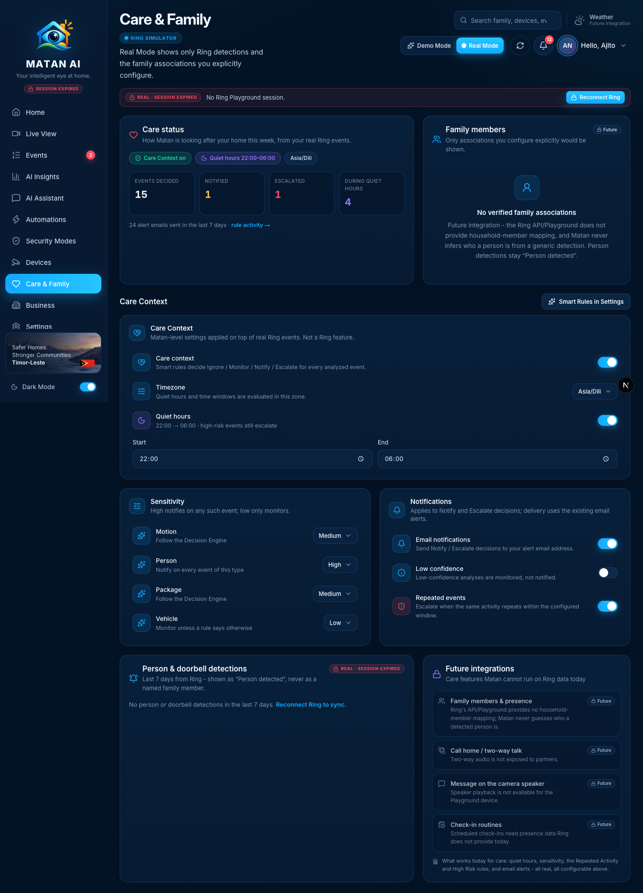
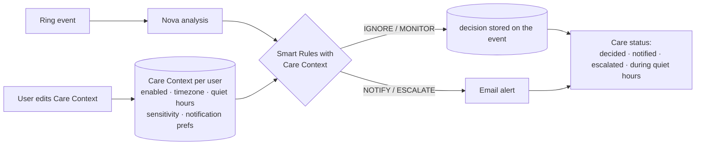

# Care & Family — Real Mode

**Route:** `/care` · **Components:** `components/pages/CarePage.tsx` → `components/experience/real-mode-care.tsx` (Real Mode) + `components/care/CareRulesPanel.tsx` · **APIs:** `GET/PUT /api/matan/care`, `GET /api/ring/events?range=7d`

Care & Family is where the user tunes how Matan looks after the home. In Real Mode the care model is Matan's own per-account **Care Context** — quiet hours, per-type sensitivity and notification preferences, stored in DynamoDB — applied by the Smart Rules to every analyzed Ring event. There are no synthetic family members and no identity guessing: Ring only reports "person detected", and Matan shows exactly that. Demo Mode keeps its sample family, presence and check-in features.

## How it works

- **Quiet hours** are evaluated in the Care Context timezone; during them motion/person activity is monitored unless repeated or high-risk (High Risk always escalates).
- **Sensitivity** per event type: *high* notifies on every such event, *medium* follows the Decision Engine, *low* only monitors unless a rule says otherwise.
- **Notification preferences**: email on/off for Notify/Escalate, low-confidence handling, repeated-event escalation.

## Sections and functions

| Area | What it shows / does | Source | State |
| --- | --- | --- | --- |
| Care status | Care Context on/off, quiet-hours window, timezone; this week's **events decided**, **notified**, **escalated**, **during quiet hours**; alert emails sent; link to rule activity | `/api/matan/care` + last 7 days of real events | ✅ real |
| Family members | Explained as a future integration (no household mapping in the Ring API/Playground; Matan never infers identity) | — | 🔒 future integration |
| Care Context card | **Care context** toggle, **Timezone** select, **Quiet hours** toggle + start/end | `PUT /api/matan/care` | ✅ real, per user |
| Sensitivity | Motion / Person / Package / Vehicle: low · medium · high | `PUT /api/matan/care` | ✅ |
| Notifications | Email notifications, low-confidence alerts, repeated-event escalation | `PUT /api/matan/care` | ✅ |
| Smart Rules in Settings | Opens Settings › Care & Rules (rule list and editor; also on the Automations page) | — | ✅ |
| Person & doorbell detections | Last 7 days of Ring person/doorbell events as "Person detected", click → event | Ring history | ✅ |
| Future integrations | Family members & presence, call home / two-way talk, message on the camera speaker, check-in routines — each with the reason | — | 🔒 future integration |

## Future integrations shown on this page
- **Family members & presence** — no household-member mapping in the Ring API/Playground.
- **Call home / two-way talk**, **speaker messages** — audio is not exposed to partners / unavailable on the Playground device.
- **Check-in routines** — need presence data Ring does not provide.

## Changes made during the Real Mode audit
- Real Mode Care rebuilt around the real per-user Care Context: the previous "Care Features" toggles wrote to the shared demo family store and affected nothing; they are gone. The Care Context / Sensitivity / Notifications panels (the same ones as Settings › Care & Rules, minus the rule list) are embedded here.
- New **Care status** summary computed from the user's real decisions and emails of the last 7 days.
- "Add family member" no longer pretends; the card is labelled **Future** with the reason, and the demo-only care actions (call, message, check-in, routine) are listed as future integrations.
- The demo family API is no longer fetched in Real Mode.

## Verified
- 2026-09-21, signed-in Real Mode session: Care Context on, quiet hours 22:00–06:00 (Asia/Dili), status = 15 events decided · 1 notified · 1 escalated · 4 during quiet hours · 24 alert emails (7 days); sensitivity/notification controls are the same components verified end-to-end in `docs/CARE_CONTEXT_SMART_RULES.md`; no person detections in the window (Playground simulations were package/vehicle/animal) with the *Reconnect Ring to sync* hint while the token was expired.
