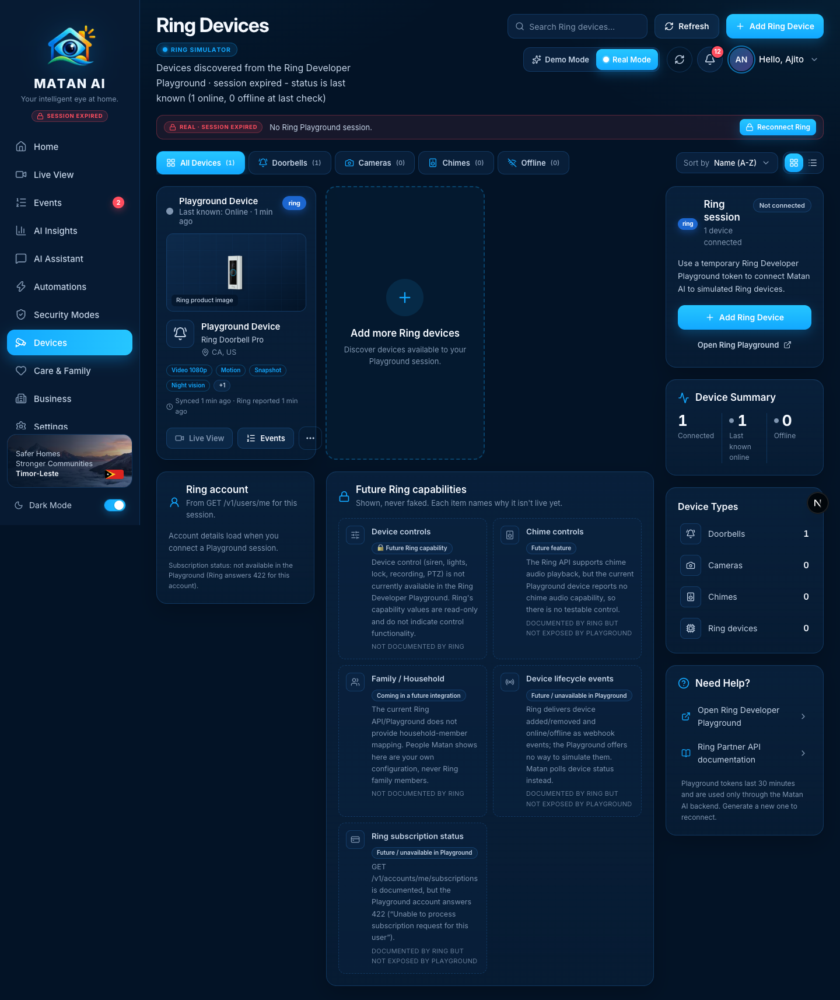
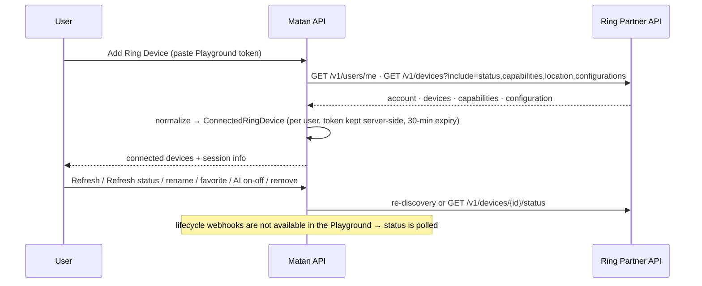
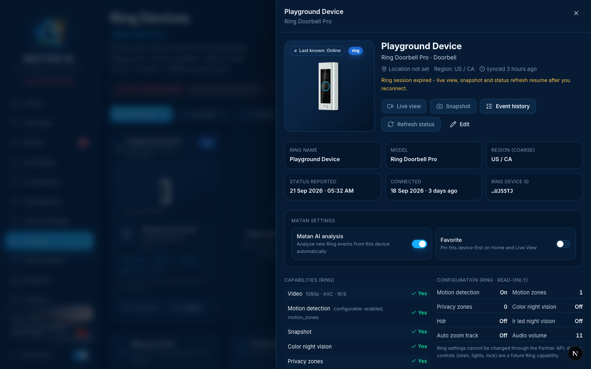

# Devices — Real Mode

**Route:** `/devices` (detail drawer `/devices/{id}`) · **Components:** `components/pages/DevicesPage.tsx` → `components/devices/ring-devices-view.tsx`, `ring-connected-device-card.tsx`, `ring-intelligence.tsx`, `add-ring-device-modal.tsx` · **APIs:** `/api/ring/session`, `/api/ring/devices`, `/api/ring/devices/{id}` (PATCH/DELETE), `/api/ring/devices/{id}/status`, `/api/ring/refresh`, `/api/ring/disconnect`

Devices is the Ring connection page: it discovers the devices available to the user's Ring Developer Playground session, shows what Ring reports about each one (status, capabilities, configuration, region, account) and lets the user manage how Matan treats them. This page was built in the *Ring Account & Device Intelligence* milestone with the rule "shown, never faked", so the audit found the data already real; the changes are about Real Mode purity and layout.

## How it works

## Sections and functions

| Area | What it shows / does | Source | State |
| --- | --- | --- | --- |
| Header + banner | Counts (online / connection expired), **Refresh** (re-discovery), **Add Ring Device** (token modal), session countdown / **Reconnect Ring** | `/api/ring/session`, `/api/ring/refresh` | ✅ |
| Filters | All / Doorbells / Cameras / Chimes / Offline, search, sort, grid/list | client | ✅ |
| Device card | Ring product image, name, model, coarse region, capability chips, *synced / Ring reported* times, **Live View** (disabled while the session is expired), **Events**, menu (rename, favorite, Matan AI analysis on/off, refresh status, remove from Matan). While the session is expired the status reads **Last known: Online · N hours ago** (grey) instead of a live green *Online* | `/api/ring/devices` | ✅ real |
| Add more Ring devices | Opens the token modal | — | ✅ |
| Detail drawer (redesigned) | Hero with product image, status (last-known when expired), name/model, location, region, sync time; quick actions **Live view**, **Snapshot** (real Ring image, needs a live session), **Event history**, **Refresh status**, **Edit**; facts grid; **Matan settings** with real toggles (Matan AI analysis, Favorite → `PATCH /api/ring/devices/{id}`); **Capabilities (Ring)** and **Configuration (Ring · read-only)** side by side; **Remove from Matan AI** | Ring discovery + Matan settings | ✅ |
| Ring session card | Connected count, token state, **Add Ring Device**, **Open Ring Playground**, **Disconnect** | session | ✅ |
| Device Summary / Device Types | Counts derived from connected devices; online count labelled *Last known online* while the session is expired | client | ✅ |
| Ring account | From `GET /v1/users/me` (masked email, region); subscription status explained as unavailable (Playground answers 422) | session | ✅ (needs a live token) |
| Future Ring capabilities | Device controls, chime controls, family/household, lifecycle events, subscription status — each with the reason and Ring documentation status | `lib/ring/capabilities.ts` | 🔒 future integration (explicit) |
| Need Help? | Links to the Playground and Partner API docs | — | ✅ |

### Device detail

## Future integrations shown on this page
- **Device controls** (siren, lights, lock, recording, PTZ) — not documented by Ring.
- **Chime controls** — documented, but the Playground device has no chime audio.
- **Family / Household mapping** — not documented by Ring; Care & Family people are Matan's own configuration.
- **Device lifecycle webhooks** — documented, not simulable in the Playground (Matan polls).
- **Subscription status** — documented, Playground answers 422.

## Stale status after the token expires

Ring only tells Matan a device's status while a Playground token is valid (`GET /v1/devices/{id}/status`, or the discovery includes). Once the 30-minute token lapses nothing can re-check it, so Matan keeps the last reported value but must not present it as current. Since the audit:

- Devices page: **Last known: Online · 4 hours ago**, grey dot, header "session expired – status is last known", Device Summary *Last known online*.
- Home: the *Devices online* tile becomes **"— · Status unknown (reconnect)"** and the Device Status mini-cards say *Last known: online*.
- Security Modes: cameras/devices online counts are reported as 0 (unknown) until reconnect.
- Implementation: `Device.statusStale` is set by `ringToDevice(d, live)` in `lib/ring/adapter.ts` when `usableToken()` is null; the Devices page derives it from the session state.

## Changes made during the Real Mode audit
- Real Mode no longer offers the **Demo devices** source switch or the "Browse demo devices" fallback — only Ring devices are shown (Demo Mode keeps both).
- Layout rebalanced: the Ring account and Future Ring capabilities cards moved under the device grid (two columns) instead of a ~3000 px right rail beside an almost empty device column.
- **Device detail drawer redesigned** (wider, hero + quick actions incl. real Snapshot, real Matan toggles, Ring capabilities and configuration side by side).
- Expired-session device status is shown as *last known* everywhere instead of a live *Online*.

## Verified
- 2026-09-21, signed-in Real Mode session (token expired at the time): one Playground device shown as *Last known: Online · 4 hours ago*, Live View / Snapshot / Refresh status correctly disabled with the *reconnect* hint, Favorite toggle in the drawer → `PATCH 200` both ways, capability matrix and configuration rendered read-only, future capabilities listed with reasons; discovery, status refresh and the account card were verified live in the Device Intelligence milestone (`docs/RING_ACCOUNT_DEVICE_INTELLIGENCE.md`).
