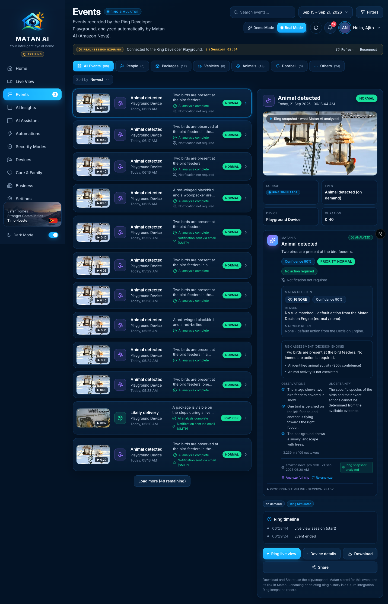
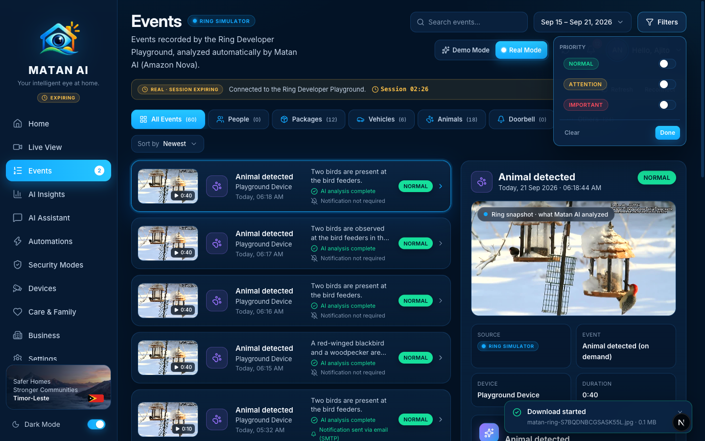
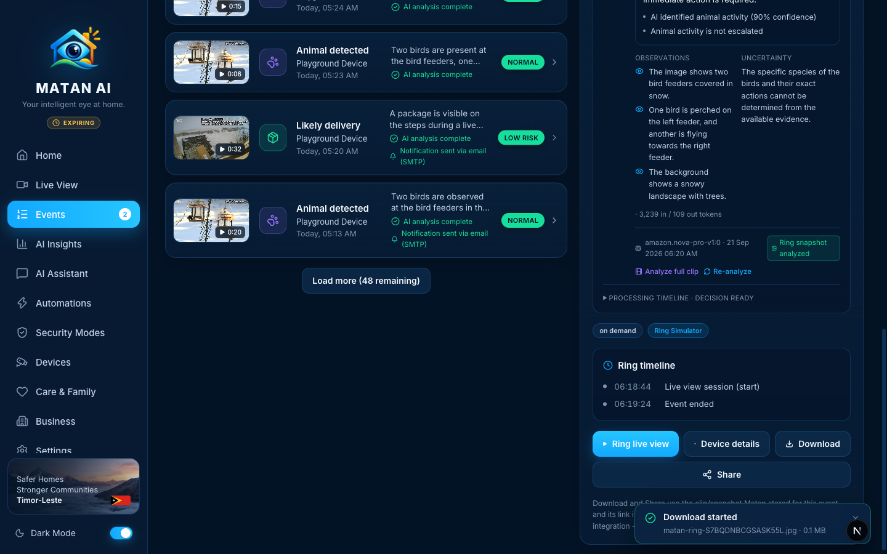

# Events — Real Mode

**Route:** `/events` (deep link `/events/{id}`) · **Component:** `components/pages/EventsPage.tsx` · **Detail:** `components/matan/EventDetail.tsx` (Ring branch) + `components/matan/MatanAnalysisPanel.tsx` · **Data:** `GET /api/ring/events` → `buildRingEventList` (`lib/ring/overview.ts`)



Events is the history of everything the connected Ring device recorded, with Matan AI's analysis, decision and notification outcome attached to each entry. In Real Mode the list, counts, filters and the detail panel are built from the signed-in user's Ring Playground history plus Matan's own records in DynamoDB/S3. Nothing here is sample data.

## How it works

```mermaid
flowchart TD
  A[Ring history<br/>GET /v1/devices/{id}/history] --> C[getRingEvents]
  B[(DynamoDB<br/>EVENT# · ANALYSIS# · MEDIA# · NOTIFICATION#)] --> C
  C --> D[overlayProcessingState<br/>analysis · notification · stage timestamps]
  D --> E[buildRingEventList<br/>search · category · priority · sort · paging]
  E --> F[Events list + category counts]
  F -->|select| G[GET /api/ring/events/{id} → EventDetail]
  G --> H[MatanAnalysisPanel<br/>Nova result · Decision · Smart Rules · timeline]
  H -->|Analyze full clip / Re-analyze| I[POST /api/matan/analyze → runMatanPipeline]
  I --> B
  F -->|poll 30 s · 6 s while analyzing| E
```

- Every new Ring event is analyzed automatically (`scheduleAutoAnalysis`); the list polls so the *AI analysis complete* and *Notification sent / not required* lines appear without a reload.
- Ring records Matan's own live-view sessions and snapshots as `on_demand` history entries. Very short ones (≤ 6 s, right after a Matan media request) are skipped by auto-analysis; longer live-view sessions are real Ring events and are analyzed like any other.

## Sections and functions

| Area | What it shows / does | Source | State |
| --- | --- | --- | --- |
| Search | Matches title, device, summary and tags of real events | `?search=` (server-side) | ✅ |
| Date range | Today / last 7 days / last 30 days | `?range=` | ✅ |
| Filters → Priority | Normal / Attention / Important toggles (priority comes from Matan's Decision Engine) | `?priority=` | ✅ |
| Category tabs | All / People / Packages / Vehicles / Animals / Doorbell / Others with real counts | `categoryCounts` | ✅ |
| Sort | Newest / Oldest / Priority | `?sort=` | ✅ |
| Event rows | Stored snapshot thumbnail, clip length, title, device, time, Nova one-liner, **AI status line**, **notification line** (*sent via SES/SMTP* / *not required* / *failed*), priority badge, *New* marker for events that arrived since the page opened | Ring + Matan overlay | ✅ |
| Load more | Pages of 12 with remaining count | `meta.hasMore` | ✅ |
| Detail → media | The exact clip or snapshot Matan analyzed (served from S3 through the authenticated `/api/matan/media/{id}`) | `MEDIA#` | ✅ |
| Detail → facts | Source, Ring event type, device, duration | Ring history | ✅ |
| Detail → Matan AI panel | Nova summary, confidence, priority, **Matan decision** (Ignore / Monitor / Notify / Escalate) with reason and matched Smart Rules, risk assessment, observations / uncertainty, model + token usage, **Analyze full clip**, **Re-analyze**, processing timeline (7 steps) | `ANALYSIS#`, `careDecision` | ✅ |
| Detail → Ring timeline | Ring's own step list for the event (session start, event ended, …) | Ring history | ✅ |
| **Ring live view** | Opens `/live` on this device | — | ✅ |
| **Device details** | Opens `/devices/{id}` | — | ✅ |
| **Download** | Downloads the stored clip (`.mp4`) or snapshot (`.jpg`) with the user's token | `/api/matan/media/{id}` | ✅ real |
| **Share** | Native share sheet when available, otherwise copies the `/events/{id}` link | Web Share / clipboard | ✅ |
| Rename / delete / notes / "add to report" | Not offered for Ring events — Ring keeps the history record; only Demo events have these | — | 🔒 future integration |

### Filters



### Detail actions



## Future integrations shown on this page
- **Editing or deleting Ring history** — the Ring Partner API is read-only for history; Matan explains this under the action buttons instead of pretending to delete.
- **Weather** chip (top bar) — no weather provider connected.

## Changes made during the Real Mode audit
- Subtitle no longer says analysis "runs with the Bedrock milestone" — it states that events are analyzed automatically by Matan AI (Amazon Nova).
- Ring event detail gained real **Download** (stored clip/snapshot via the protected media API; `downloadProtectedMedia` in `hooks/useProtectedMedia.ts`) and **Share** buttons, replacing the "not available in this preview" note; the remaining limitation (rename/delete) is stated explicitly.

## Verified
- 2026-09-21, signed-in Real Mode session: 60 real events in the last 7 days (12 packages · 6 vehicles · 18 animals · 24 others), rows show AI status and notification outcome (SMTP fallback while SES is in sandbox), detail shows the analyzed snapshot with Nova result and Matan decision, **Download** → `matan-ring-<id>.jpg` + toast, **Share** → native share sheet.
