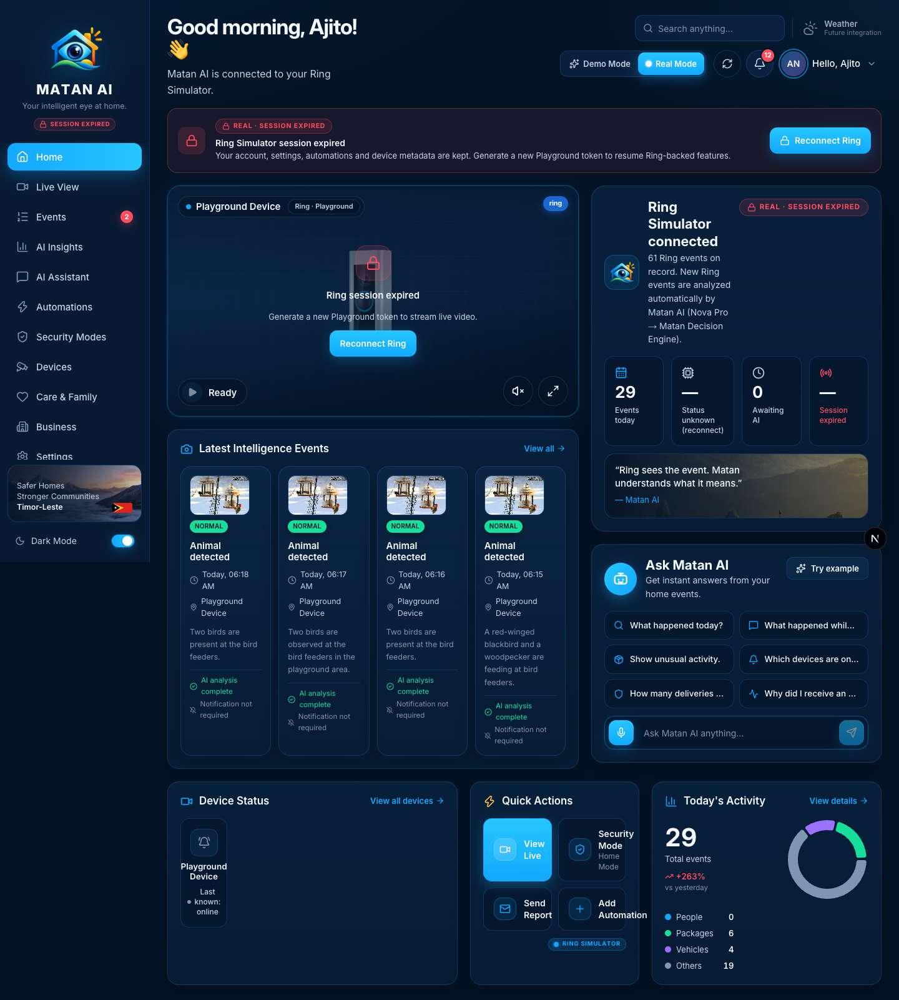
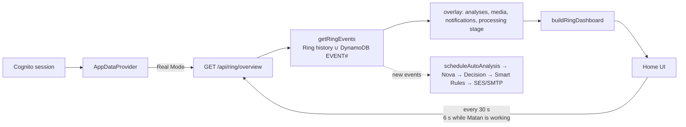
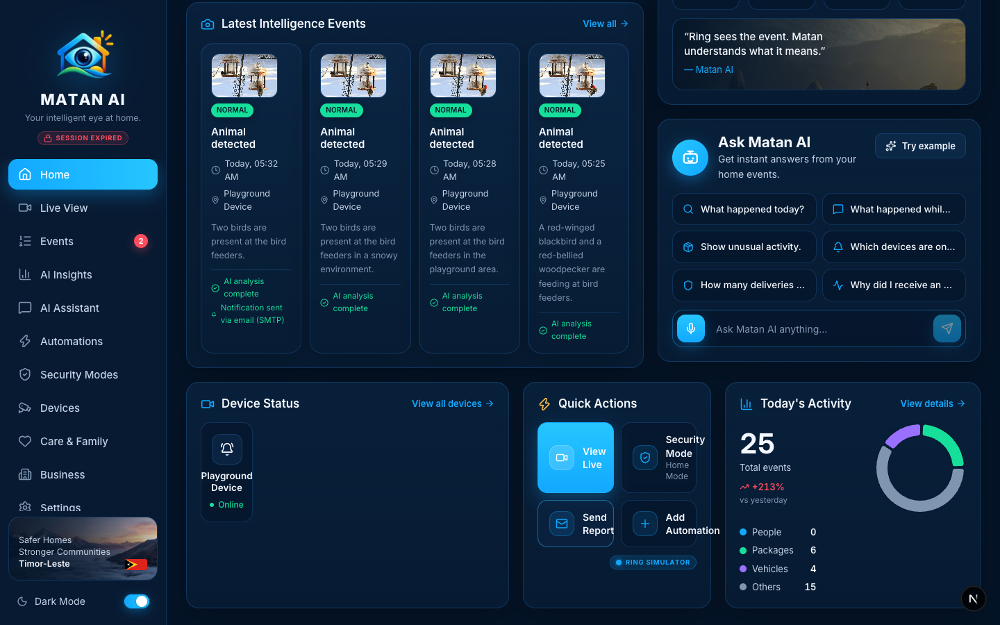
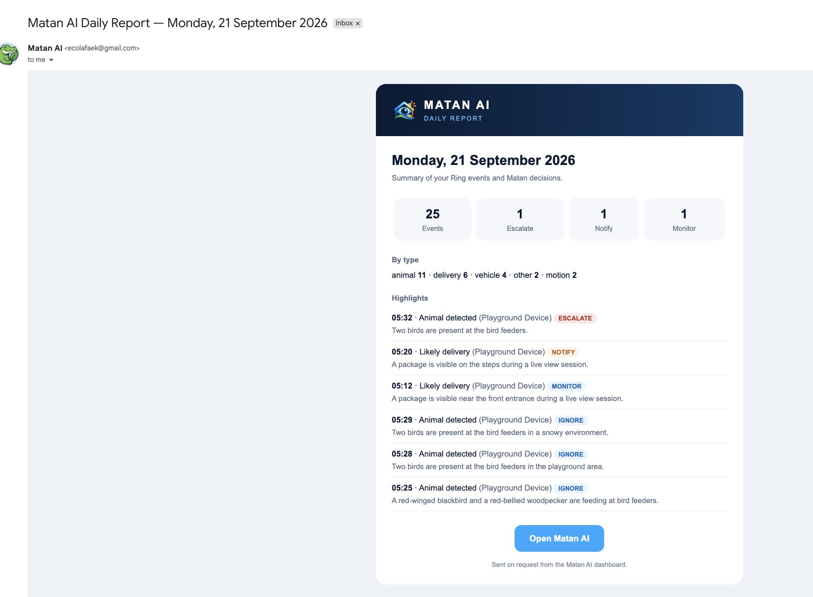

# Home — Real Mode

**Route:** `/` · **Component:** `components/pages/HomeDashboard.tsx` · **Data:** `GET /api/ring/overview` (Real Mode) via `AppDataProvider`

Home is the Real Mode landing page: a live view of the connected Ring device, the latest Matan-analyzed events, today's numbers, quick actions and the Matan AI assistant. Everything shown comes from the signed-in user's Ring Playground data and Matan's own analyses — nothing is sample data in Real Mode. Elements that are not backed by a real integration are labelled *Future integration* rather than showing placeholder numbers.

## How it works

`AppDataProvider` polls the overview every 30 s (6 s while any of the latest events is capturing/analyzing), so new Playground events, their analyses and notification outcomes appear without a manual refresh.

## Sections and functions

| Area | What it shows | Source | State |
| --- | --- | --- | --- |
| Greeting | "Good morning, *first name*" from the Cognito profile; subtitle "connected to your Ring Simulator" | Cognito ID token | ✅ real |
| Search | Free text → **Search events** → `/events?search=…` | client | ✅ |
| Weather chip (top bar) | **"Weather · Future integration"** | — | 🔒 future integration (Demo Mode shows sample weather) |
| Demo / Real switch, Refresh, bell, profile | Mode switch (Demo ↔ Real), manual refresh of the overview, notification inbox, account menu (My account / Settings / Sign out) | `ExperienceProvider`, `AppDataProvider`, Cognito | ✅ |
| Real Mode banner | Playground status: token countdown (`expires in mm:ss`), **Refresh** (re-discovery + history resync), **Manage Ring Connection**; turns into *Session expired → Reconnect Ring* when the 30-minute token lapses | `/api/ring/session`, `/api/ring/refresh` | ✅ |
| Live view player | Real WebRTC/WHEP stream of the Playground device: **Start Ring live view**, mute, fullscreen; *Ready* badge | `POST /api/ring/devices/{id}/stream` → Ring WHEP | ✅ (needs a live token) |
| Latest Intelligence Events | Four newest Ring events with Nova summary, priority badge, **AI status line** ("AI analysis complete"), **notification line** ("Notification sent via …" / "not required"), *New* badge for events that arrived since the page loaded; click → event page | `latestEvents` (Ring history + Matan analyses) | ✅ |
| Ring Simulator connected card | Total Ring events on record (all history), explanation of automatic analysis; tiles **Events today**, **Devices online** (becomes *Status unknown (reconnect)* once the token expires, because Ring status cannot be re-checked without it), **Awaiting AI**, **Session left** | `historyCount`, `todayCounts`, devices, session | ✅ |
| Ask Matan AI | Six quick questions + free-text input; answers are computed from the user's real Ring events (`answerRing`); **Try example** | `POST /api/assistant?mode=ring` | ✅ · 🎤 **Voice input → future integration** (toast) |
| Device Status | Connected Ring devices with online/offline dot (*Last known: online* while the session is expired); **View all devices** | `/api/ring/devices` | ✅ |
| Quick Actions | **View Live** → `/live` · **Security Mode** → `/security-modes` (shows the active Matan mode) · **Send Report** · **Add Automation** → `/automations?create=1` | see below | ✅ |
| Today's Activity | Total events today, % vs yesterday, donut by type (people / packages / vehicles / others); **View details** → `/insights` | `todayCounts` from Ring history | ✅ |

### Send Report (real)
`POST /api/matan/report` builds **today's** summary from the user's real Ring events in the care-context timezone — totals by type, Matan decision counts (Escalate / Notify / Monitor / Ignore) and up to six highlights — and emails it to the address in Settings → Notifications through the same SES → SMTP transport as alerts. One report per 10 minutes per user (`NOTIFICATION#REPORT-<bucket>#EMAIL`); the toast reports *sent (via …)*, *already sent*, *not sent: set an alert address*, or the failure code. In Demo Mode the button only simulates and says so.

### Notifications bell (real)
The inbox is derived from Matan's own decisions on real events: every **NOTIFY** / **ESCALATE** decision and every email actually sent becomes an item (title, reason, time, link to the event). Read state is kept per user (`POST /api/ring/notifications`); the empty state explains what will appear. Demo Mode keeps its sample notifications.

### Sidebar badge
The red counter on **Events** is the number of today's Ring events rated *attention* or *important* by the Decision Engine.

## Future integrations shown on this page
- **Weather** — no weather provider is connected; the chip says so instead of showing demo values.
- **Voice input** — microphone button explains it is a future integration; typing works.

## Changes made during the Real Mode audit
- Weather chip and voice input labelled as future integrations in Real Mode.
- "N Ring events on record" now uses the full history count instead of the 4-item preview list.
- **Send Report** replaced its fake success toast with a real daily-summary email (rate-limited, real data only; Demo Mode clearly simulated).
- Notification bell in Real Mode now lists real Matan decisions/emails with read state and an empty state (was an empty list).

## Verified
- 2026-09-21, signed-in Real Mode session: page rendered from real Playground data (1 device online, 25 events today, 4 analyzed events with notification lines), Send Report → email sent, second click → `429` duplicate guard, token expiry → *Session expired* banner.
