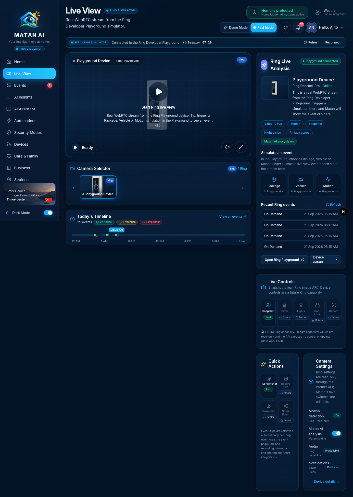
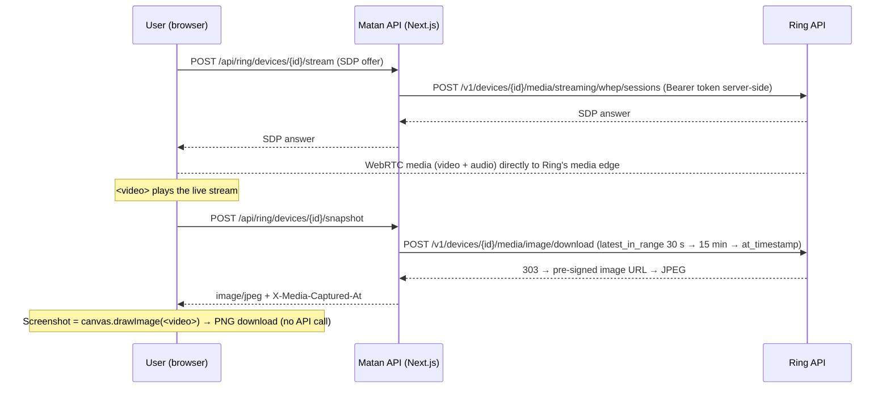
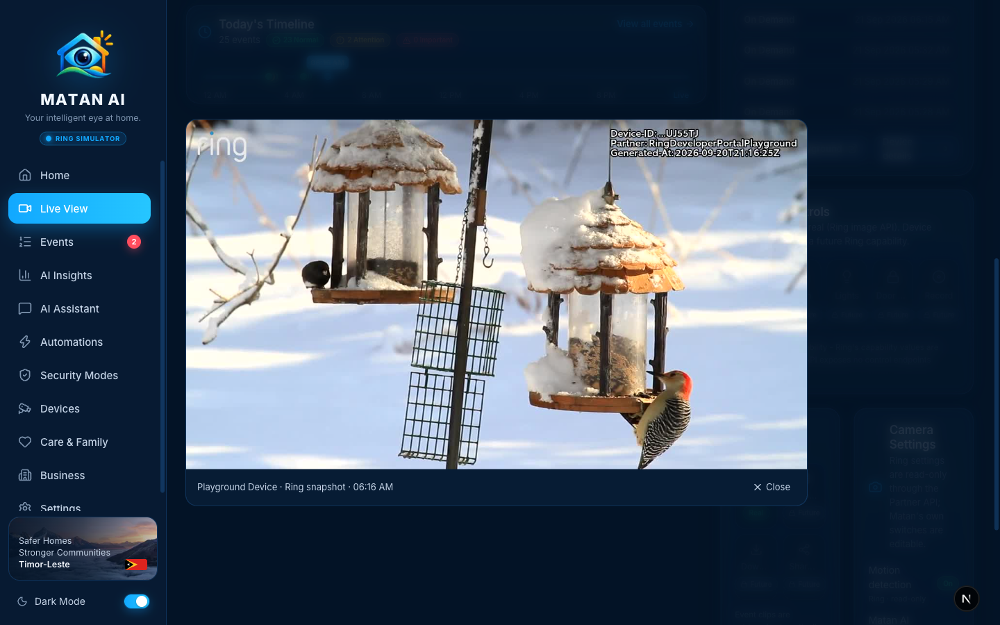
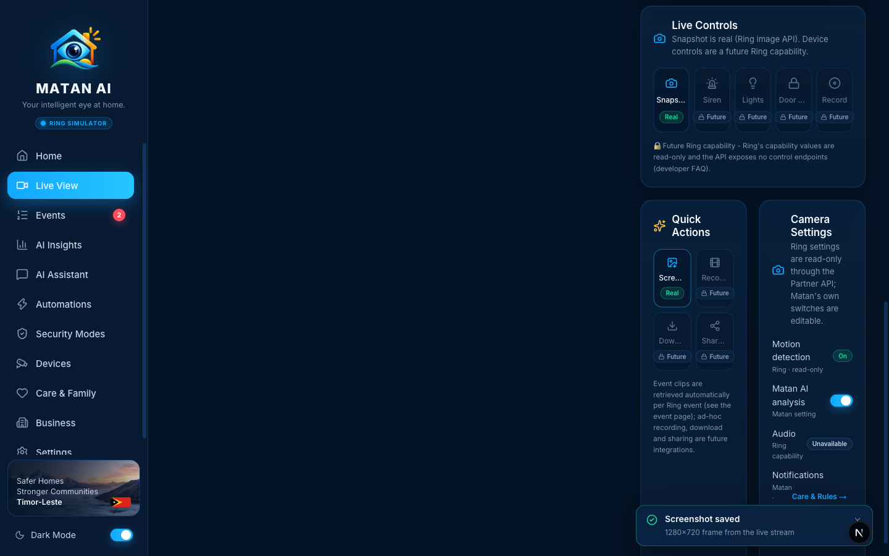

# Live View — Real Mode

**Route:** `/live` · **Component:** `components/pages/LivePage.tsx` · **Ring pieces:** `components/devices/RingLivePlayer.tsx`, `components/devices/ring-live-tools.tsx`

Live View is where the user watches the connected Ring device in real time. In Real Mode the page is driven only by the signed-in user's Ring Playground: the WebRTC stream, the device card, today's timeline and the snapshot / screenshot actions are real, and everything Ring's Partner API does not expose (siren, lights, door lock, ad-hoc recording, download, share) is shown as **Future** instead of being faked.

## How it works

- The Ring token never leaves the server: the browser only exchanges SDP with Matan; media flows over WebRTC once the answer is applied.
- The Playground device only holds images for windows where something was streamed or simulated, so **Snapshot needs the live view to be running** (or a Package / Vehicle / Motion simulation in the last 15 minutes). Otherwise the API answers `404 RING_NO_SNAPSHOT` and the page explains what to do.
- Snapshot requests are registered with `noteOwnMediaRequest()` so the auto-analysis scheduler ignores the short `on_demand` history entries that Ring records for Matan's own media calls.

## Sections and functions

| Area                                                 | What it shows / does                                                                                                                                                                                                                                                            | Source                                                | State                 |
| ---------------------------------------------------- | ------------------------------------------------------------------------------------------------------------------------------------------------------------------------------------------------------------------------------------------------------------------------------- | ----------------------------------------------------- | --------------------- |
| Header + Real Mode banner                            | Playground status, token countdown, **Refresh**, **Reconnect**                                                                                                                                                                                                                  | `/api/ring/session`                                   | ✅                    |
| Player                                               | **Start Ring live view** → WebRTC/WHEP stream (1080p AVC from the Playground); mute, fullscreen; status badge _Ready → Connecting… → Live_                                                                                                                                      | `POST /api/ring/devices/{id}/stream`                  | ✅                    |
| Camera Selector                                      | Only the user's connected Ring devices (demo tiles are hidden in Real Mode); `?camera=ring:<id>` selects one                                                                                                                                                                    | `/api/ring/devices`                                   | ✅                    |
| Today's Timeline                                     | Real events of today plotted on a 24 h track with Normal / Attention / Important counts, live "now" marker; **View all events**                                                                                                                                                 | `getDataSource("ring").getEvents({ range: "today" })` | ✅                    |
| Ring Live Analysis card                              | Device name, model, online state, capability chips (video, motion, snapshot, night vision, privacy zones), _Matan AI analysis on/off_, **Simulate an event** shortcuts (open the Playground), recent Ring events with **Refresh**, **Open Ring Playground**, **Device details** | Ring device discovery + history                       | ✅                    |
| Live Controls → **Snapshot**                         | Fresh JPEG from Ring's image API, shown in a viewer with the real capture time                                                                                                                                                                                                  | `POST /api/ring/devices/{id}/snapshot`                | ✅ real               |
| Live Controls → Siren / Lights / Door Lock / Record  | Labelled **Future** — Ring's capability values are read-only and the Partner API has no control endpoints (developer FAQ)                                                                                                                                                       | —                                                     | 🔒 future integration |
| Quick Actions → **Screenshot**                       | Grabs the current frame of the `<video>` element into a PNG download (`matan-<device>-<ts>.png`); enabled only while the stream is live                                                                                                                                         | client canvas                                         | ✅ real               |
| Quick Actions → Record Clip / Download / Share Event | **Future** — event clips are fetched per Ring event by the Matan pipeline (see the event page), not started from here                                                                                                                                                           | —                                                     | 🔒 future integration |
| Camera Settings → Motion detection                   | Read-only badge from Ring's device configuration                                                                                                                                                                                                                                | `GET /v1/devices/{id}/configurations`                 | ✅ read-only          |
| Camera Settings → Matan AI analysis                  | Real toggle; turns Matan's automatic analysis on/off for this device                                                                                                                                                                                                            | `PATCH /api/ring/devices/{id}` (`aiEnabled`)          | ✅                    |
| Camera Settings → Audio                              | Capability badge (the Playground device reports no audio)                                                                                                                                                                                                                       | `GET /v1/devices/{id}/capabilities`                   | ✅ read-only          |
| Camera Settings → Notifications                      | Link to **Settings → Care & Rules** (Smart Rules decide what is emailed)                                                                                                                                                                                                        | —                                                     | ✅                    |

### Snapshot (real)

The viewer shows the frame Ring returned (the Playground watermarks it with its own device id and generation time) and the capture time from `X-Media-Captured-At`. Failure cases are reported honestly: _No snapshot_ when Ring has no image yet, _Session expired_ when the Playground token lapsed (the banner offers **Reconnect**).

### Screenshot (real)

Screenshot does not call Ring: it draws the live `<video>` frame onto a canvas and downloads it as PNG (1280×720 from the Playground stream). It is disabled until the stream is live.

## Future integrations shown on this page

- **Siren, Lights, Door Lock, Record** — no device-control endpoints exist in the Ring API today.
- **Record Clip, Download, Share Event** — ad-hoc recording/sharing is not exposed; Matan already fetches the clip of every Ring event automatically.
- **Ring settings** (motion detection etc.) — readable, not writable.
- **Weather** chip (top bar) — no weather provider connected.

## Changes made during the Real Mode audit

- Real Mode no longer mixes demo cameras into the selector, the timeline or the "now" marker; today's timeline is built from the user's real Ring events with a real clock.
- New `POST /api/ring/devices/{id}/snapshot` route (server-side token, 30 s → 15 min → point-in-time fallback, capture time header, own-footprint note for auto-analysis).
- Live Controls, Quick Actions and Camera Settings replaced the demo mock panels with `RingLiveControls`, `RingQuickActions`, `RingCameraSettings` and `SnapshotViewer`: real Snapshot, real Screenshot, real Matan AI toggle, read-only Ring configuration, everything else marked **Future** with the reason.
- Labels fit the side column (wrapping instead of truncating).

## Verified

- 2026-09-21, signed-in Real Mode session: stream connected (WebRTC 1280×720), **Snapshot** → `200 image/jpeg` with capture time shown in the viewer; **Screenshot** → PNG download (1.18 MB) + toast; without a live stream Snapshot returns `404 RING_NO_SNAPSHOT` with the "start the live view first" hint; timeline 29 real events (27 normal · 2 attention).
