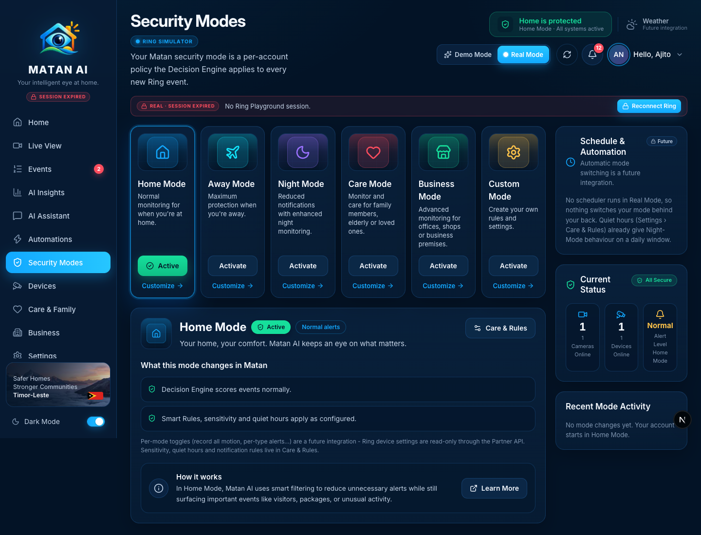
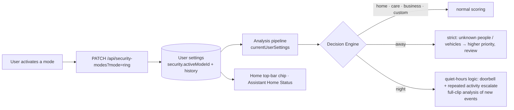
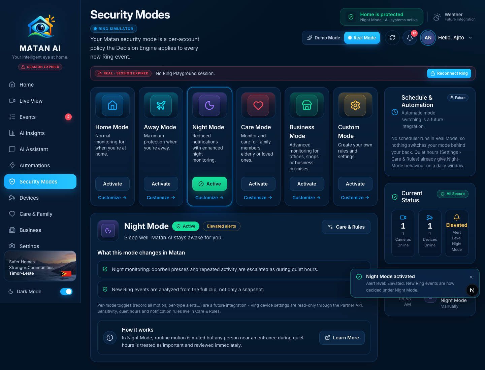

# Security Modes — Real Mode

**Route:** `/security-modes` · **Component:** `components/pages/SecurityModesPage.tsx` · **API:** `GET/PATCH /api/security-modes?mode=ring` → `lib/matan/security-modes.ts` · **Storage:** per-user settings item (`USER#{sub}` / `SETTINGS` → `security.activeModeId`, `security.history`)

A security mode is a Matan-level policy, not a Ring device setting: it tells the Decision Engine how strictly to score new Ring events. In Real Mode the active mode is stored per account, survives restarts, and is read by the analysis pipeline for every new event. The page explains exactly what each mode changes today and labels the demo-only features (schedules, per-mode toggles, mode-specific policies for Care/Business/Custom) as future integrations.

## How it works

- The Decision Engine (`lib/matan/decision.ts`) treats `night` like quiet hours and `away` as strict; the pipeline (`lib/matan/analysis.ts`) analyzes the full clip for new events in Night Mode. Other modes currently score like Home — the page says so under *What this mode changes in Matan*.
- Smart Rules still run after the Decision Engine, so a rule can override the mode's default decision.
- Nothing switches the mode automatically in Real Mode; the mode only changes when the user activates one (each change is logged in *Recent Mode Activity*).

## Sections and functions

| Area | What it shows / does | Source | State |
| --- | --- | --- | --- |
| Mode cards | Home / Away / Night / Care / Business / Custom with **Activate** (Away asks for confirmation) and **Customize** (opens the detail below) | static definitions + user's active mode | ✅ real |
| Selected mode detail | Name, *Active / Not active*, alert level, description, **What this mode changes in Matan** (real effects; *Future* note where a mode has no specific policy yet), **How it works**, **Learn More** | `effects` from the API | ✅ |
| Care & Rules button | Opens Settings › Care & Rules — sensitivity, quiet hours and notification rules live there | — | ✅ |
| Per-mode setting toggles (demo) | Hidden in Real Mode; explained as a future integration (Ring device settings are read-only through the Partner API) | — | 🔒 future integration |
| Schedule & Automation | Labelled **Future**; explains that no scheduler runs and that quiet hours already provide Night-Mode behaviour on a daily window | — | 🔒 future integration |
| Current Status | Cameras online, devices online (from the connected Ring devices), alert level of the active mode | Ring discovery | ✅ |
| Recent Mode Activity | The user's own mode changes with real timestamps (newest first, last 12) | `security.history` | ✅ |
| Top-bar chip | "Home is protected · *Mode* · All systems active" follows the active mode | `/api/ring/overview` | ✅ |

### Night Mode active

## Future integrations shown on this page
- **Automatic mode switching / schedules** — no scheduler; quiet hours cover the nightly case.
- **Per-mode toggles** (record all motion, per-type alerts, email per mode) — Ring settings are read-only; Matan's own notification behaviour is configured in Care & Rules.
- **Care, Business and Custom policies** — these modes currently score like Home; the note on each card says so.

## Changes made during the Real Mode audit
- The active mode was read from the shared demo store (global to all users, lost on restart); it is now a **per-user persisted setting** (`SettingsData.security`) used by `currentUserSettings()` for analysis and by the Real Mode dashboard (`activeRingMode`).
- New `lib/matan/security-modes.ts` (`ringSecurityPayload`, `activateRingMode`, `MODE_EFFECTS`); `/api/security-modes?mode=ring` requires the Cognito user, persists the mode, logs the change, and refuses schedule/toggle changes instead of pretending.
- Page: Real Mode shows real effects instead of demo toggles, marks schedules as future, uses the real clock for the activity log, and links to Care & Rules.

## Verified
- 2026-09-21, signed-in Real Mode session: activate **Night Mode** → `PATCH 200`, card *Active*, detail shows the two real effects, *Recent Mode Activity* logs "Switched to Night Mode · Manually" with the real time, top-bar chip switches to "Night Mode"; activate **Home Mode** → back, second log entry. Status: 1/1 cameras, 1/1 devices online.
