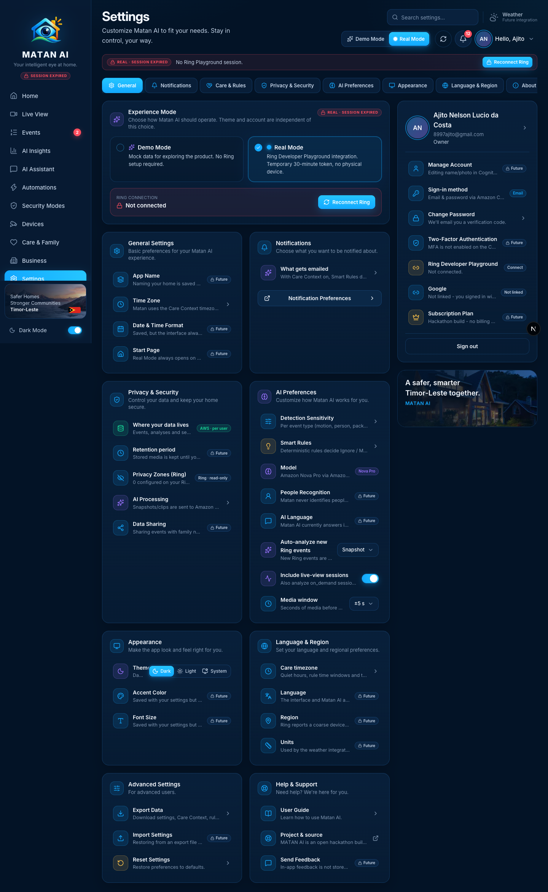
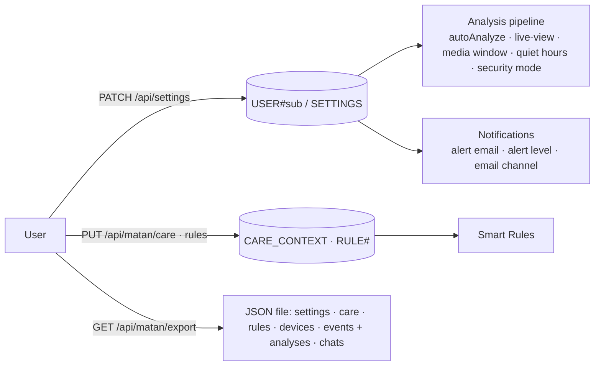
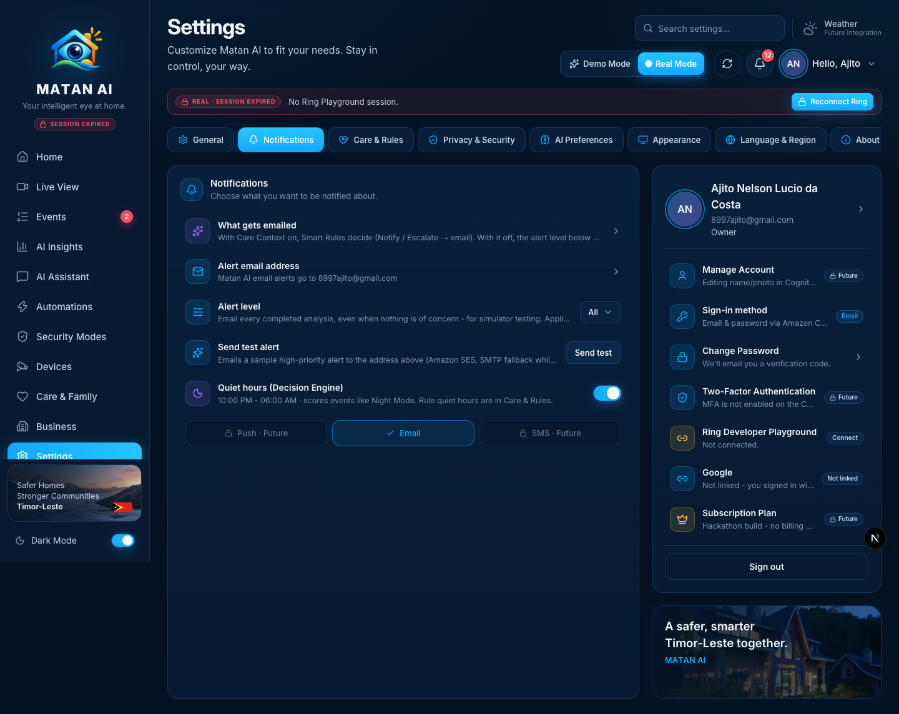
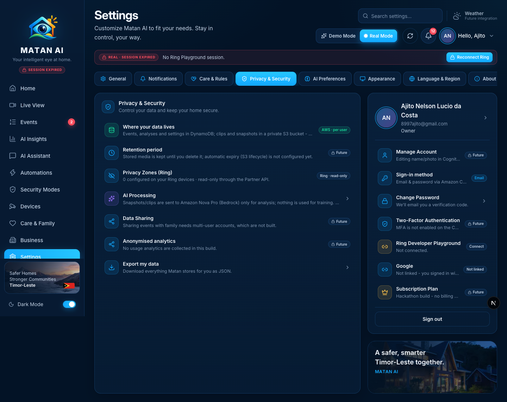
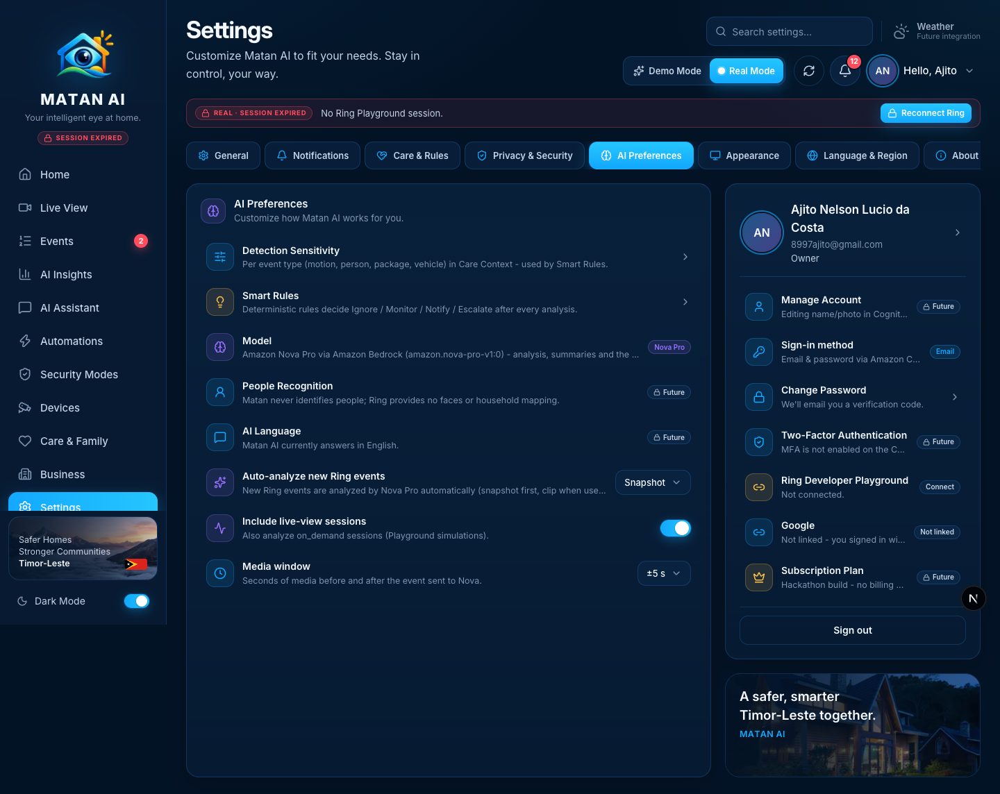

# Settings — Real Mode

**Route:** `/settings?tab=general|notifications|care|privacy|ai|appearance|region|about` · **Component:** `components/pages/SettingsPage.tsx` (+ `components/care/CareRulesPanel.tsx`, `components/experience/experience-settings-card.tsx`) · **APIs:** `GET/PATCH/POST /api/settings` (per-user `SETTINGS` item), `/api/matan/care`, `/api/matan/rules`, `POST /api/matan/test-alert`, `GET /api/matan/export`

Settings holds everything the user can configure. In Real Mode every control either changes something Matan really does (alerts, Care Context, Smart Rules, auto-analysis, theme, Ring connection, account) or is labelled **Future** with the reason — nothing is saved with a "success" toast while doing nothing. Settings are stored per Cognito user in DynamoDB; the profile card is the signed-in identity (Cognito or Google), never the demo profile.

## How it works

## Tabs and functions

| Tab | Real | Future integration (labelled) |
| --- | --- | --- |
| **General** | Experience mode (Demo / Real) + Ring connection card; Time Zone → points to the Care Context timezone | App name, date & time format, start page (saved but not applied anywhere) |
| **Notifications** | *What gets emailed* explainer (Smart Rules when Care Context is on, alert level when off), **alert email address**, **alert level** (high / medium / low / all), **Send test alert** (SES → SMTP), **Quiet hours (Decision Engine)** toggle, **Email** channel | Push and SMS channels |
| **Care & Rules** | Care Context (enabled, timezone, quiet hours), sensitivity per event type, notification preferences, Smart Rules list + editor — all per user | — |
| **Privacy & Security** | *Where your data lives* (DynamoDB + private S3, per user, no Ring tokens), **Privacy Zones (Ring)** count read from device configuration, *AI Processing* explainer → AI tab, **Export my data** | Retention period (no S3 lifecycle yet), data sharing, anonymised analytics |
| **AI Preferences** | Detection sensitivity → Care Context, Smart Rules → Care tab, **Model** (Amazon Nova Pro via Bedrock), **Auto-analyze new Ring events** (off / snapshot / snapshot + video), **Include live-view sessions**, **Media window** (±5 s / ±10 s) | People recognition, AI language |
| **Appearance** | **Theme** (Dark / Light / System) | Accent colour, font size (saved, not applied) |
| **Language & Region** | Care timezone → Care tab | Language, region, units (weather is not connected) |
| **About** | Real build facts (Ring Playground + AWS services, Nova Pro, source repository) | — |
| **Advanced** (General/About) | **Export Data** → real JSON download; **Reset Settings** (per user) | Import settings; *Reset App* is Demo-only and hidden |
| **Help & Support** | User guide, **Project & source** (GitHub) | Send feedback |
| **Account card** | Cognito/Google identity, **Sign-in method**, **Change Password** (email/password accounts, via the verification-code flow), **Ring Developer Playground** status + connect, **Google** linked/not linked, **Sign out** | Manage account (name/photo), two-factor authentication (MFA not enabled on the pool), subscription plan |

### Notifications

### Privacy & Security · AI Preferences

### Export

`GET /api/matan/export` streams a JSON attachment (`matan-ai-export-<date>.json`) with the user's settings, Care Context, Smart Rules, connected devices (no tokens), Ring events with Matan analyses / decisions / notification outcomes (media URLs stripped — clips and snapshots are downloaded per event) and assistant conversations. The browser fetches it with the Cognito token (`downloadProtectedMedia`).

## Changes made during the Real Mode audit
- Every inert or demo-only control is a **Future** row in Real Mode (toast explains why): notification category toggles, push/SMS, retention, data sharing, analytics, people recognition, AI language, accent/font size, language/region/units, app name/date format/start page, import, feedback, manage account, 2FA, subscription.
- Account card uses the signed-in Cognito/Google profile; linked accounts show the real Ring session and Google state; *Reset App* (demo store) is hidden.
- **Export Data** is real (new `/api/matan/export`), replacing a fake "12.4 MB zip" toast; Demo Mode says its export is simulated.
- Privacy tab states where data lives and reads the Ring privacy-zone count; AI tab names the model and links sensitivity/rules to Care Context.
- About card shows the real stack instead of "UI preview / no live Ring/AWS / Nova next phase".

## Verified
- 2026-09-21, signed-in Real Mode session: all seven tabs rendered with no demo leftovers (automated text scan for "next phase / preview / example.com / Pro Plan / Demo dataset / Reset App"); **Export Data** → `200`, `Content-Disposition: attachment; filename="matan-ai-export-2026-09-21.json"`, 168 KB with 61 events, 5 rules, 4 chats, 1 device, no token or media URLs; alert email, alert level, test alert and Care & Rules controls were verified end-to-end in the SES and Care milestones.
